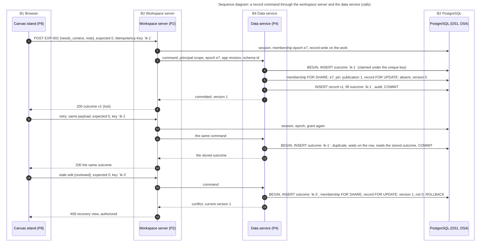

# System Design: the Forma company app platform

The industry-agnostic platform on which teams form, run, publish and reuse their own apps; Northstar and Spend Review are its two demonstration apps, designed in `tasks/forma-northstar-demo/`.

| | |
|---|---|
| **Author** | Victor Villacis |
| **Date** | 2026-10-22 |
| **Status** | Proposed |
| **Revises** | Design A v4 (`task/forma-platform/v4`) in direction: the same company platform, generalized beyond security, on a typed app definition instead of markup modules (review of 2026-10-22, K1) |
| **Reviewers** | Two fresh reviewers and the security reviewer at phase 7 (L3 strength); recorded in STATUS.md |
| **Approvers** | Victor Villacis (the head) |
| **Review by** | 2026-11-05 |
| **Read first** | `input/brief.md`; the controlling definition `input/context/forma-app-platform-product-definition.pdf`; `PRODUCT-BRIEF.md`; `SHARED-CONTRACTS.md`; `review/foundation-review.md`; design A v4 as prior art |

<!-- Section requirements: reference/GUIDE.md section 3. Voice: reference/STYLE.md. Method, numbers and patterns: reference/PATTERNS.md. -->

**How to read this record.** "The definition, §N" is section N of the controlling product definition (`input/context/forma-app-platform-product-definition.pdf`); this record's own sections are cited as plain numbers. Identifier families: **K1 to K5** are the head's kickoff rulings (`intake.md`); **C01 to C16** the shared platform and demo contracts (`SHARED-CONTRACTS.md`); **P01 to P16** and **A1 to A8** the product requirements and planning envelope of the validation plan (`VALIDATION.md`, "VALIDATION" below); **H0 to H11** the head's earlier decisions on design A; **I-1 to I-4** the gaps the foundation review found; **FORMA-NNN** tickets on the Forma work board and **BUILD-NNN** the Forma compiler's diagnostics; "the review, N" is `review/foundation-review.md`. This record defines its own **G** goals, **A** assumptions, **R** and **N** requirements, **SR** security requirements, **D** decisions, and section 7's **EE**, **P**, **DS**, **B** and **F** elements. Terms used throughout: a *space* is a company-defined area of apps inside an organization; the *canvas* is the spatial surface on which an app's views are arranged; the *composer* is the assistant that proposes app definitions; an *island* is a browser component Forma attaches to server-rendered HTML; a *receipt* is the server's record of exactly which sources, versions, parameters and policy produced a result; an *epoch* is a counter a change of filter, membership or policy advances, so a late result can be told from a current one; *FMIR* is Forma's compiled module format; *MCP Apps* are apps rendered inside an assistant such as Claude; *kmd* is the founder's separate notes product. Northstar is the fictional company, one organization, whose Security space holds the investigation app and whose Finance space holds Spend Review; the canary is a second, unrelated organization used to test isolation.

## 1. Summary

Forma is a company app platform on Forma 3.0.0 for the work that now lives in spreadsheets, scripts and chat tabs, where the denominator sits in a cell, the match rule in someone's head, pasted rows leave the company and a colleague repeats it all (section 2): a member describes an app over the organization's imported evidence, a model proposes a typed definition that first-party components render, a reviewer publishes it under policy, and every number shown carries a receipt. The design is one binary in four roles over two stores: pooled PostgreSQL rows with the organization id in every key for publications, saved work and records; immutable Parquet revisions queried by DuckDB for evidence; one data service behind receipts and record commands; a control plane that alone writes publications; fAuth behind an identity adapter. It optimises for isolation and generality, nothing of one organization reaching another and two apps through one path with no deploy between, at the expense of expressiveness, a closed vocabulary in which a new widget is a release, and of generation latency, since every proposal runs as a job. At the design point, ten organizations and 60 query operations a second at peak (A1, A2; synthetic data until a pilot, A12) for about $1,150 a month, it covers the browser workspace, imports, composition, publication, saved work, records and administration, with the Northstar demo's six acts on one build as its first proof; public pages, MCP Apps, connectors, external actions and the custom-widget tier are deferred (3.2, 13.2). Four doors are one-way, the typed definition (D1), the publication record (D2), pooled tenancy (D3) and Parquet with PostgreSQL (D4); the rest of 5.3 reverses, D15's region per organization excepted.

## 2. Context and problem statement

Forma is a company app platform to be built on Forma 3.0.0, a web framework the same founder ships.

**What exists today.** Forma 3.0.0 (`getforma-dev/forma` `v3.0.0` = `2006423b`, published 2026-10-20 with a 0 FAIL gate; review 4.1) is a compiler, a Rust server renderer and a browser runtime. It withholds, by design, identity, authorization, storage, jobs and tenancy (review 4.1, 4.4). Three Forma 2.x prototypes are donors: vector-studio generates and indexes UI modules (`131771d2`), generative-ui routes an intent to a widget on a canvas (`1dd18239`), genui-runtime extracts that canvas as a library (`93c3871e`); all resolve core 2.0.1 (genui-runtime declares `^2.0.0`) (review 4.4; design A v4, appendix B). Design A v4 is the predecessor: a security-first platform for a fictional insurer whose model writes markup admitted through the HTML runtime (its D13). This record differs by ruling K1: an industry-agnostic platform whose model proposes a typed `AppDefinition` (C04) rendered by first-party compiled components, verified on 3.0.0 (review 4.3); design A's markup path becomes a later custom-widget tier. The two demonstration apps, Northstar's six-card investigation and Spend Review's finance queue with an internal decision form, are designed in `tasks/forma-northstar-demo/` (L2), bound by this record (C16), and recorded in six acts: enter the workspace, bring evidence, form and transform, publish and run, share and reuse, a different app.

**What breaks today, as a mechanism.** Northstar's fixture (demo `SCENARIOS.md` S02, S05; synthetic), done by Maya with "spreadsheets, queries, scripts, dashboards, or recurring reports" (the definition, §3):

1. Maya exports ten minutes of connection events for `build-worker-17` to a CSV: rows only, no source revision, no statement of whether `bytes` is per event or cumulative.
2. She matches destinations against the inventory with a worksheet lookup that returns its first match; `203.0.113.10` has an exact entry and a `203.0.113.0/24` network entry, so a lookup that stops at the first match can take the network entry over the exact one and a lookup that does not can count the connection twice, and the rule, exact first and once only, lives in her head.
3. She sums 1,140,000 bytes and divides: 228,000 bytes/minute over the 5 minutes the events span, 114,000 over the 10-minute window. The sheet shows the number without its denominator; the conversion "requires a defined time interval, denominator, and unit" (§9).
4. She asks a chat model what the 900,000 unmatched bytes to `198.51.100.7` mean. The pasted rows leave the company's access control; the answer cites no query and is gone when the tab closes.
5. She emails Sarah a verdict and a screenshot, not the window, the match rule or the inventory revision. Jordan, investigating `ops-runner-04`, repeats steps 1 to 4; the team must "reconstruct the workflow from a collection of detached files and private prompts" (§1).
6. Finance repeats this with money: a 64,000-cent spending table filtered at 20,000 cents to a 45,000-cent queue in one sheet (S05), where the decision on EXP-002 is an overwritable cell with no version, author or transition history.

The prototypes do not close this. generative-ui serves one person on loopback "until authentication is implemented" (`src/server/mod.rs:510-516`); nothing publishes a generated module, since the registry and routing index load once at startup (`src/registry.rs:455`, `src/server/mod.rs:523-551`); a dataset is one JSON value of at most 2,000 rows by 32 columns from a 5 MiB file (`src/local_data.rs:91-100`); widgets mount through 2.x `reconcile`, not 3.0.0's `mountMarkup` (design A v4, §2). None has an organization, saved work, a writable form or a publication policy.

**Market framing.** YC's Fall 2026 Requests for Startups include "A Cloud for Small Software" by Pete Koomen: "Small software should be as easy to share with your colleagues as a Google Doc." The definition calls Forma's alignment with it "our interpretation" (§20); the request prescribes no app and promises no funding.

**Constraints.** Technical: Forma 3.0.0 at its pin, with FORMA-232 and FORMA-246 assumed done but not built (K3, A14; appendix B). The compiler admits a finite subset of TypeScript for server rendering, which shapes the renderers: a renderer picks a card's kind from booleans the server declares, because a computed comparison is refused (BUILD-610); components inline at most three levels deep; the inert state a page carries to the browser is capped at 1 MiB; a route whose bundled framework code exceeds 28,100 B gzip is refused, and the spike's canvas used 27,674 B (review 4.2, 4.3). The model proposes data, never code, markup or grants (C04). Connected sources are read-only; only records inside Forma are writable (§10, §18). Organisational: one founder builds and runs it; no customer, date, team or budget is supplied (`input/constraints.md`); the YC demo is the first audience; fAuth (A11; live at `auth.getforma.dev`) is a sibling product whose demo-viability check passed (A11); the identity adapter boundary holds either way (K4). Conventions: synthetic data only; Northstar is fictional; only measured numbers are facts; every stack claim is pinned. Dependencies carry MIT, Apache-2.0, BSD or MPL-2.0 licences only, checked in CI (M12).

**Scale regime.** A startup's, no users and no forecast; section 4 sizes an envelope from VALIDATION's A1 to A8 (3.3), targets, not forecasts.

## 3. Goals, non-goals, and assumptions

### 3.1 Goals

The design goals are **generality** (one typed definition, first-party renderers), **governed persistence** (publication records, saved work), **correct and traceable data** (receipts, record commands), **isolation** (organization id in every key, row-level security) and **honest AI** (labels, abstention, validation).

- **G1 Two apps, one build.** Done when Northstar's investigation and Spend Review's queue and form come through the supported authoring path on one build digest, no platform code branches on a tenant or space name, and each of the demo's eight reductions names the platform seam that replaces it (P15; §18).
- **G2 Publication and saved work are governed.** Done when a publication binds exact definition, input-contract, record-schema and renderer identities; Northstar's review policy and an owner-publish policy work; a stale approval or any author or model policy change is refused; pinned work adopts a version only by explicit compare-and-set (P09, P10).
- **G3 Every number is exact and has a receipt.** Done when the fixtures recompute (1,140,000 bytes, 900,000 unmatched; 64,000 cents), totals cover the full authorized input before pagination, windows are half-open, currency is integer cents, never mixed, every result carries a receipt pinning sources, operators and record snapshot, and a response from a stale epoch is discarded (P06).
- **G4 Internal records persist, retry safely and conflict visibly.** Done when a form-written record survives reload, a timeout retry with the same idempotency key yields one mutation, and two concurrent edits yield one commit and one visible conflict, never last-writer-wins, at A2's rate (P07).
- **G5 Organizations cannot reach each other.** Done when the canary organization replays every API call, search, file, record, job and cache lookup with Northstar's identifiers and gets nothing, and revocation reaches an open display within 5 seconds (P11).
- **G6 The AI is labeled, bounded and dispensable.** Done when each creation is labeled retrieval, adaptation or generation; of ten supported and five adversarial intents, every admitted result validates and every unsupported abstains; injected evidence widens nothing; in a provider outage, navigation, published queries and forms work and generation fails visibly (P12, P13).
- **G7 (fuzzy) Cheaper than the spreadsheet it replaces.** A team forms and keeps a second app with less effort than its spreadsheet and scripts; measurable only against a pilot baseline that does not yet exist.

Success: a second app beside Northstar with no developer touching platform code, continued by a colleague, every section 4 target measured. Failure (intake item 35): a security-only product disguised as a platform, hidden per-app coding, nonpersistent forms, unsafe sharing, wrong evidence or no recurring demand.

### 3.2 Non-goals

- **Public websites and the site server**: a public surface adds threats, not completeness evidence (C14).
- **MCP Apps or any assistant host**: an extension once the browser workflow is dependable (§18).
- **Live connectors and external actions**: sources stay read-only; one bounded action follows demand (§22); "reviewed" never means payment (C07).
- **Live coediting** (§1) and **scheduled workflows**: visible conflicts cover handoff; unsubmitted mutation breaks the authority model (C04).
- **A cross-company marketplace or template exchange**: catalogs stay private until content rights and review duty are settled (§22).
- **Arbitrary code or markup generation**: K1 defers the custom-widget tier (FORMA-237 to 242); the first release needs no sanitizer, no admission of untrusted FMIR and no translator, and drops two High/High threat rows (review, section 5).
- **fAuth as a full identity provider**, **tenant-managed keys, a second region, money movement** and **kmd**: separate tracks (H6 to H9, H11).
- **An accounting engine, packet capture, clinical decisions, autonomous remediation**: naming them commits nothing (§18).
- **A schedule or launch plan**: the head owns dates, team and budget.

### 3.3 Assumptions

A1 to A8 are VALIDATION's envelope.

- **A1 Population.** 10 organizations × 10 members = 100 seats; 3 active each = 30 concurrent. If wrong: admission, isolation and cost are reworked before a pilot.
- **A2 Interactive load.** One interaction per user per 10 s = 3/s, 18 query operations/s over six linked views, 2 submissions/s on one record. If wrong: queue controls, never weaker authorization.
- **A3 Source volume.** 20 revisions × 10 organizations × 25 MiB = 4.88 GiB of originals a month, twice that normalized, 43.95 GiB over 90 days, before records, indexes, audit and backups. If wrong: measure before costing.
- **A4 Bounds.** CSV at most 100 MiB and 1 million records; XLSX at most 10 MiB compressed, 100 MiB expanded, 10,000 rows × 32 columns per sheet; parse time and memory bounded. If wrong: reduce until demonstrated.
- **A5 Admission.** One import and one generation job per organization, three and five globally, a capped visible queue. If wrong: fair scheduling or separate workers, never silent loss.
- **A6 Lifecycle, synthetic only.** 90-day retention and audit, seven-day backups, idempotency outcomes kept 24 hours. If wrong: customer retention, deletion and retry horizon are open questions, not these values.
- **A7 Recovery.** RPO 24 hours and RTO 4 hours proven by restore; records survive a restart. If wrong: backup, replication and cost change.
- **A8 Operating model.** One managed browser offering, one region, one operator, manual membership, a named owner before live data. If wrong: region, providers, team and support hours are open; a team relaxes paging.
- **A9 Hosting.** AWS, one region (design A v4's choice) until the head rules otherwise. If wrong: section 11's hosting and cost change.
- **A10 Generation provider.** Claude behind a provider interface, re-verified at the claims phase. If wrong: the adapter swaps and the disclosure policy renames (C12).
- **A11 Identity.** fAuth (`getforma-dev/gatewasm` at `b750ca53`) is the first adapter; its viability check passed (`review/fauth-viability.md`); its sign-in is ruled in (2026-10-23, delegated to the lead) as a quiet real moment, a minimal platform login behind the same boundary as the fallback. If wrong: section 6's sessions change, not authority semantics.
- **A12 Data.** Synthetic only; Northstar is fictional. If wrong: data classes, threat model and policy are settled before any real row.
- **A13 Precedence.** The controlling definition governs where the two product definitions differ. If wrong: the security-first framing returns; sections 2, 3 and the demo's acts are recut.
- **A14 Stack.** FORMA-232 and FORMA-246 are done before the build ships and the review's 4.2 contracts hold at `2006423b`. If wrong: the canvas route must fit 28,100 B by measurement (426 B of headroom, review 4.3); a moved contract reopens K1.
- **A15 Peak.** Every seat active at once, 3.3 times average. If wrong: admission limits and N1's node count move, not the contracts.
- **A16 Record cadence.** One record a minute per active practitioner, about 2 KiB with its audit row. If wrong: section 8's capacity and N3's commit window change.
- **A17 Search freshness.** The catalog index may lag a publication by 60 s and reauthorizes on use. If wrong: rebuild on publication; retrieval never grants access.
- **A18 Roles.** Two or three builders, one reviewer, one administrator among ten members. If wrong: section 4's rates rescale.

## 4. Requirements

| Stakeholder | Concern | Section |
|---|---|---|
| Builder | an app from data and intent; precise edits; honest limits | 6, 7 |
| Practitioner | correct numbers; records that persist; work that reopens | 7, 8 |
| Reviewer | exactly what was approved ships | 7, 10 |
| Administrator | membership, policy, isolation, deletion | 9, 10, 11 |
| Forma operator | jobs, budgets, restore; no organization data | 11 |
| The head; the demo's lead | two apps, one path, no platform code between | 5, 12 |

### 4.1 Functional

First-release users are manual enterprise members of one organization, roles overlapping when policy permits (the definition, §3); programmatic parties are callees; an MCP Apps host, a live connector and an external action MAY follow this release, none is in it (the definition, §18; C14). Roles and rates per organization are section 3's (A1, A2, A3, A5, A8, A16, A18): builders import a working day with one generation in flight; practitioners, three of ten active, interact every 10 s and commit a record a minute; the reviewer decides a few times a week, the administrator changes membership and policy a few times a month, the operator reads health, jobs and quotas daily.

- **R1** A member MUST reach one stable space or app by click or alias and Enter; home and suggestions show only permitted items; unknown input creates nothing and calls no model; a context switch discards late results (P02; C03, C11).
- **R2** Opening an app MUST offer "continue saved work" and "start new work" distinctly; new work copies nothing of the author's (P03; C01, C02, C10).
- **R3** A builder MUST import CSV and bounded XLSX by drop or a keyboard-accessible Upload control into an inspected source card with confirmed mappings and units; the assistant MAY suggest mappings and sensitive fields, never apply them (review I-4); imports are immutable revisions; no macro runs (P05; C05).
- **R4** A builder MUST create or change an app by controls or intent, each result labeled retrieved, adapted or generated; the composer MAY ask one bounded clarifying question (review I-2); outside the grammar it abstains and names the missing capability; every app declares what completion means (review I-3; P04; C04, C08, C13).
- **R5** A change MUST be a patch on a named base revision with a semantic diff, undo a further revision, a stale patch a conflict; previews use synthetic data unless policy allows a read preview under the previewer's access; draft writes go to an isolated store (P04, P08, P16; C08, C12).
- **R6** Every value shown MUST be computed server-side over the full authorized input before pagination, with a receipt pinning sources, snapshot, operators, parameters and policy epoch; a failed calculation is an error, never a zero (P06; C04, C06).
- **R7** The canvas MUST pan, zoom, move, resize, group, fit and save layouts; linked views share a declared filter and show its scope; a keyboard path and a focused view MUST complete the same tasks (P16; C03).
- **R8** A practitioner MUST create and update app-owned records through declared forms and commands carrying an expected version and an idempotency key; a retry returns the original outcome, a stale edit conflicts; a decision is internal, never a payment or source update (P07; C07, C14).
- **R9** Publication MUST follow the organization's versioned policy, independent review or administrator-configured owner publication, binding exact definition and renderer versions; neither author nor model changes policy; a failing draft never disables the published version (P09; C09).
- **R10** Existing work MUST stay pinned; adoption is explicit after seeing the changes; an incompatible schema is blocked without a migration; rollback reverses no record and revives no access (P10; C02, C10).
- **R11** Sharing an app, sharing work and exporting MUST be separate operations under separate permissions; links carry identifiers, not access; revocation stops future results, queued ones included; delivered data is stated as unrecallable (P03, P11; C06, C11).
- **R12** The assistant's tools MUST be separate: compose, set parameters, query, explain, propose a command; the user submits every mutation; an explanation's numbers match its receipts; policy names the provider and the disclosed fields, off until configured (P12; C12).
- **R13** Published apps, navigation, deterministic queries and internal forms MUST work while the model provider is down; model-dependent operations show that state (P13; C14).
- **R14** The runtime MUST contain no branch on an organization, space or app name; a new app from supported primitives MUST need no deploy; a new primitive is an engineering release (P01, P15; C13, C16).
- **R15** Every request MUST carry a verified principal from one identity adapter that checks issuer, audience, signature, expiry, revocation and membership; nothing trusts a client- or model-supplied identity; fAuth is the first adapter (K4; C01).
- **R16** Administrators MUST manage membership, spaces, aliases, ownership, retirement and deletion; operators MUST see jobs, quotas, budgets and restore state without organization data; admission is A5's slots; high-impact actions are audited (P11, P14; C01, C15; A5).

### 4.2 Quality requirements (non-functional)

Load: A1 and A2 give 3 interactions/s and 18 query operations/s across six linked views; at peak all 100 seats, 10 interactions/s and 60 operations/s, 3.3 times average (A15), the design point. Commits: one a minute a user, 0.5/s; tested at 2/s on one record. The tail drives the design: a 1-million-record source under a six-way refresh and one hot record. Storage: 43.95 GiB over 90 days (A3); 18,000 commits a business day at about 2 KiB, 0.75 GiB a month (A16).

- **N1 Scalability.** Ten times the design point (100 organizations, 1,000 seats, 300 concurrent on average, 600 operations/s at peak) by adding query and app capacity with no contract or code change; the design point fits one PostgreSQL and one query node. Confirmed by open-loop load at 10x on one build.
- **N2 Availability.** No contractual figure until hosting, a support owner and failure measurements exist (A8; the definition, §13). Internal objective for the published-app path (R13): 99.5% of valid requests a month, 3.65 hours, which one full restore at RTO (A7) would exceed by 21 minutes, so the objective assumes none in a month, measured at the gateway; generation and explanation fail visibly with no objective.
- **N3 Latency at the client**, authorization and network included, from real-user telemetry per business hour (10,800 interactions, enough for p99). SLO: median and p99 below the table in 99% of business hours a month; the targets are VALIDATION's candidates. Generation and import are cold paths: state within 1 s, duration measured, not promised. First paint: Core Web Vitals, LCP 2.5 s at p75 per device class, Forma code under 28,100 B gzip a route (27,674 B measured, review 4.3).

  | Flow | Criticality | p50 | p99 |
  |---|---|---|---|
  | Navigation: home, space, app open | critical | 250 ms | 1 s |
  | Warm bounded query, one six-view refresh (each operation at p99.83) | critical | 500 ms | 2 s |
  | Record commit acknowledgement, one transaction (C07) | critical | 300 ms | 1 s |
  | Revocation to an open display (the epoch poll plus one request); new requests reauthorize | important | | 5 s |

- **N4 Fault tolerance.** Safety: no fault serves another organization's data, widens authority, duplicates a record or shows a number without a receipt. Liveness: queued jobs complete or fail visibly; committed records survive a restart; RPO 24 h and RTO 4 h proven by restore into an isolated environment (A7; P14).
- **N5 Consistency.** Record commands are linearizable per record: one PostgreSQL transaction enforces idempotency, expected version, audit and membership epoch (C07; safety); publication and adoption are atomic compare-and-set (C09, C10; safety); the submitter reads their own write; search may lag 60 s and reauthorizes on use; revocation reaches open displays within 5 s (liveness) and every new request reauthorizes (safety). Confirmed by G4's retry and conflict tests and S06's two-way ordering test.
- **N6 Accuracy.** Exact integer arithmetic, server-side, on the fixtures: 1,140,000 bytes, 900,000 unmatched, 114,000 bytes a minute over the full ten minutes; 64,000 cents and the 45,000-cent queue; no floating-point money, no cross-currency sum without a declared conversion (S02, S05). On the frozen ten supported and five adversarial intents every admitted result validates, every unsupported one abstains and every number matches its receipt (VALIDATION); fifteen is diagnostic, not a score.
- **N7 Security.** Nothing of one organization reaches another; no model output, copied link, stale job or guessed identifier widens authority (C01, C11, C12); confirmed by the cross-tenant suite against the canary organization and the S06 table.
- **N8 Privacy.** The composer sees schemas and synthetic examples by default; real rows reach the provider only under a policy naming the fields; raw evidence never enters prompt or audit logs (C08, C12); confirmed by inspecting every provider request in the evaluation run.
- **N9 Maintainability.** One build runs both apps with zero commits and deploys between them, its runtime naming no tenant (P15, R14; C13); Forma pinned at v3.0.0 (`2006423b`) with FORMA-232 and FORMA-246 assumed done (K3).
- **N10 Cost.** The budget is unknown (A8), so the requirement is the meter: hosts, stores, query work, model tokens, backups and egress attributed per organization monthly, generation stopped at a configured budget (C15); section 11 derives the figure.
- **N11 Sustainability.** No separate target: model calls dominate the footprint, and retrieval before generation (R4) plus the budget stop (N10) bound them; one region (A9).
- **N12 Accessibility.** WCAG 2.2 AA for the shell and the component library (review I-1): automatic checks on every component state at build, a keyboard-only run of S01 and a screen-reader pass per release; light or dark and other settings persist (the definition, §5).

Scenarios (source, stimulus, environment, artifact, response, measure). **Linked refresh (N3):** at peak, on a 1-million-record source, a practitioner selects a destination in one of six views; all six answer from one filter epoch, p99 under 2 s at the client, no prior-epoch result shown; open-loop load at twice peak on S02. **Isolation (N7):** the canary organization calls every endpoint with Northstar's identifiers; every role is denied before data or metadata, audited; zero leaks. **Fault (N2, N4):** the provider fails for an hour at peak; published apps, queries and forms stay inside N3, generation shows queued or failed within 1 s, nothing partial activates; a drill. **Change (N9):** Spend Review is built from form, status and detail primitives Northstar never used; the revision and deployment logs show no change; S07's packet.

Ranked: N7, N9, N6, N5, N3. N7 is never traded; N9 is the claim the release is judged on (the definition, §18); N6 and N5 make a saved decision worth keeping; N3 makes it feel like a tool. Acknowledge now, deliver later: imports, generation, exports, indexing. Complete before answering: record commands, publication, adoption, saves. Lowered on purpose: generation latency, search freshness, the availability figure, cold import time; cross-currency sums are rejected, not converted.

Faults: hardware, by redundancy in managed stores and stateless hosts; correlated software faults, by constrained parser workers, the canary organization on every release and a published version that outlives a failing draft; human error, the leading cause, by confirmed interpretations, semantic diffs, independent review and undo; a cross-organization leak or model-widened authority is prevented, not tolerated. Data classes are 10.6's: Restricted, Confidential, Internal, no Public (C14); the demo is synthetic.

- **SR1** Every read and write MUST be scoped by the session's organization, DuckDB confined to its cache (M1, M2, M18, M19, M36, M37, M39). Test: the canary suite and hostile-view corpus, zero leaks, no foreign search hit, no export beyond its grant.
- **SR2** One adapter MUST verify fAuth's token offline behind back-channel PKCE, re-check the epoch per request, refuse cross-site changes (M3 to M7, M24, M25, M45). Test: forged token, reused code, revoked cookie, cross-site POST refused within 5 s.
- **SR3** Internal calls MUST carry a signed service token the callee re-checks; roles hold disjoint grants (M16, M17). Test: `workspace` cannot insert a publication.
- **SR4** The model MUST reach only five tools, none returning rows, and read untrusted text as data; proposals validated whole (M26, M27, M30, M31). Test: the fifteen-intent suite, S06's injected field, no query result in any provider request.
- **SR5** Imports MUST parse in a WebAssembly sandbox with no system interface, under A4's caps (M8, M9). Test: an XLSX inflating past 100 MiB refused; fuzzing; a module importing a socket or file interface rejected at build.
- **SR6** Publication MUST check digest, policy version and approver epoch in one SERIALIZABLE transaction, approver ≠ author (M10, M11). Test: stale, replayed approvals refused.
- **SR7** Results MUST be re-authorized before release and match their receipt; idempotency keys scoped to organization, principal, work and command (M20, M21, M32, M33, M40, M44, M46, M47). Test: canary digest denied; another principal's key finds nothing; re-derivation matches.
- **SR8** Releases MUST build from pinned lockfiles and SHA-pinned actions, signed, with an SBOM (M12, M13). Inspection: provenance; an unsigned digest refused.
- **SR9** Operator access MUST be just in time, breakglass sealed with an outside reader, destructive changes two-person, an organization's deletion after a 24-hour hold (M14, M15, M49). Demonstration: both drills.
- **SR10** Audit MUST be insert-only, hash-chained and anchored every 15 minutes (M22, M23). Test: no role updates or deletes; chain verified.
- **SR11** Data MUST be minimised and shredded: per-organization keys, policy-named fields only, allowlisted logs, tombstones replayed after restore (M34, M35, M38, M41 to M43, M48). Test: restore drill, provider-request inspection, log scan.
- **SR13** Definition strings MUST render escaped and SVG MUST be built from numbers, never strings (M50, M51). Test: the hostile-definition corpus; no CSP report.
- **SR12** Every security control MUST fail closed and every organization MUST stay inside its slots and budget (M28, M29). Test: unreachable key set, KMS or membership refuses; 10x load spares others.

## 5. Architecture overview

Forma is one company workspace in which a typed app definition, proposed by a model or formed by hand, is admitted, published under the organization's policy, run over immutable sources and writable records, and kept as saved work colleagues reopen. The trade is section 1's, ranked in section 4: isolation and generality, two apps from one build with nothing crossing an organization, over expressiveness (the closed vocabulary, D1) and generation latency (a job, D8). Status, where first named: **[built]** at a pin (Forma 3.0.0 `2006423b`, fAuth `b750ca53`, the native composition fixture of review 4.3); **[proposed]**, this design; **[deferred]**, designed for later. The demo (`tasks/forma-northstar-demo/`) is a slice of this record, one process, synthetic data, the same contracts (G1, C16); 5.3 marks what binds it.

A worked scenario on the demo's fixtures (SCENARIOS S01 to S05), as if the platform exists.

1. Maya signs in at Northstar's branded, invite-only fAuth page [built]. The workspace server verifies the EdDSA token against the cached key set, takes the organization from `tenant_id` and the person from `sub`, mints the session and shows the spaces her membership permits [proposed] (D6; R1, R15).
2. She drops the connection events CSV and the inventory XLSX onto the canvas; two import jobs are recorded, and a worker with no network and no keys parses each and writes revision 1 as Parquet under Northstar's key [proposed] (D4, D12; R3). Maya confirms the mappings: `bytes` per event, UTC timestamps, an exact inventory entry first, a connection counted once.
3. She asks for "build-worker-17's outbound bytes for the ten minutes from 10:00, by destination, matched against the inventory". The composer worker labels what retrieval found, sends the provider schemas and synthetic rows, and gets back a typed `AppDefinition` of six linked views; the control plane admits it (schema, grammar, complexity, versions); the canvas island renders a synthetic preview from typed props [built: the rendering; proposed: the rest] (D1, D7, D8; R4). She adds a transfer-rate measure, bytes over the full ten minutes, and an observation form, each a patch on the base revision with a semantic diff (D9; R5).
4. Sarah approves diff and preview in the review inbox; her own session signs the content digest; the control plane writes the publication binding exact definition, input contracts, record schema and renderer versions under Northstar's independent-review policy, which refused Maya's own publish attempt [proposed] (D2; R9).
5. Maya opens the app and selects `build-worker-17` in [10:00, 10:10); the data service answers six typed queries over the two revisions, each with a receipt: 1,140,000 bytes, 240,000 matched, 900,000 unmatched to `198.51.100.7`, 114,000 bytes a minute over the ten-minute denominator [proposed] (D4; R6; N6). She records that 900,000 bytes went to a destination absent from the inventory, ownership unverified, and saves the case, pinning publication 1 (D14; R2).
6. She shares the work with Jordan, a separate grant; he reopens the same work id, records and pin. For `ops-runner-04` he starts new work: two events, 210,000 bytes, 30,000 unmatched, 21,000 bytes a minute, its own work id, nothing of Maya's (R2, R11).
7. In the Finance space, Spend Review forms through the same path: a 64,000-cent table, a queue at `amount_cents >= 20,000` holding EXP-002 at 45,000 cents, and a decision form. A finance member submits `needs_context` on EXP-002 with idempotency key `ik-1` and expected version 0; the data service commits record version 1, the idempotency outcome and the audit event in one PostgreSQL transaction. A retry with `ik-1` after a lost response returns that outcome, one mutation; a stale edit expecting version 0 conflicts into a recovery view [proposed] (D5; R8; N5). No payment or source update happens (D12).
8. Maya returns to the Security space: her case, filter and layout come back; a Finance query she left running answers late with the old epoch and is discarded, not shown. Separately, the canary organization replays every call with Northstar's identifiers and gets nothing, audited (D3; N7).

Like Retool, Forma serves internal apps over company data with roles, sign-in and an audit log; unlike Retool, where an app is code the platform trusts, a Forma app is a typed definition the platform validates and renders, so the model never ships code and what the reviewer approves is what runs.

Prototyped: the native composition fixture (review 4.3) de-risked rendering on 3.0.0 as shipped: a four-kind canvas compiled as one island rendered 6,752 B of HTML with every fixture value at first paint under the nonce CSP, 27,674 of 28,100 B gzip; a computed kind comparison was refused (BUILD-610), so dispatch is boolean flags. The spike for the top remaining assumption, one path carrying both apps with their guarantees, is `BUILD-HANDOFF.md`'s: admitted definition → authorized query → receipt → command → outcome → reopen, with the duplicate submission and the version conflict; it also measures DuckDB's cold aggregate over a 1-million-record revision (A4) against N3's 2 s, and the real canvas route against 28,100 B with the renderer library imported (A14). It also measures the route's server render rate and memory per render on one workspace task: pages render in Rust from compiled modules with no JavaScript engine on the server, and the spike turns that into a number. A new app is an admitted definition revision, a database row rendered by components compiled once, so it needs no build, no runtime and no engine of its own (D1, C13).

### 5.1 System context

The platform as one box, [proposed]: four kinds of person at their entry point, the browser, and the two systems it calls. fAuth is [built] at `b750ca53`.


What matters: every person enters through one session and one authorization point, and the two external systems see opposite things: fAuth sees who signs in, never data; the model provider sees schemas, catalog metadata and synthetic rows, never who asked (N8). Simplified: sign-in, a browser redirection, is drawn as the platform's call; the operator's just-in-time role is the platform's own; MCP hosts and connectors are absent as non-goals (3.2).

### 5.2 Containers

A zoom into diagram 01's platform box: the deployable roles, the stores and the trust boundaries, each [proposed] unless marked. One Rust binary, each role a deployment with its own credentials; one process for the demo (D11).


Two paths through one gate. Interactive, down the left: the browser workspace on Forma 3.0.0 core [built] adopts pages the workspace server renders from typed props [built: the rendering] and calls the JSON API through the edge; the workspace server is the one authorization point and the only caller of the control plane and the data service. Background, along the bottom: workers claim jobs from PostgreSQL, read originals, write Parquet and index files to object storage, and alone talk to the model provider. The control plane alone writes publications, policy and the governance audit; the data service alone reads Parquet and writes records with their audit events in its own transaction (6.3); published apps serve from the workspace server's own reads of publication rows, so the control plane is off that path. Left out: monitoring, backups, object storage's calls to key management, the workspace server's streaming of originals to object storage and reads of index files from it, the export download and the operator pages.

The fit check lands section 4's numbers on these boxes. **Load (A1, A2).** 30 concurrent users at one interaction per 10 s are 3 interactions/s and 18 query operations/s, 60/s at peak; at 100 ms a warm operation, assumed until measured, Little's law puts 6 in flight, so one data node running at most 8 queries at once, at most 2 per organization, carries the design point, a six-view refresh as three waves of two; section 11 runs two such tasks, one per zone, for N2 not load, organizations hashed to a preferred task so a revision cache warms once; N1's 10x adds tasks (D4). Commits, 0.5/s average and 2/s tested, are one PostgreSQL transaction each (N5), serialized per record by the row lock, so two people on one record wait milliseconds. Jobs (A5): three imports and five generations globally, one of each per organization: one worker deployment with eight slots. **Latency (N3).** Navigation at p50 250 ms is one round trip, a session read and one render of typed props, untimed until the spike. The six-view refresh at p99 2 s is one filter epoch fanned to six queries, two at a time, each at p99.83, inside about 1.8 s after the round trip (300 ms warm at the assumed 100 ms); whether DuckDB's cold aggregate over a 1-million-record revision fits waits on the spike, with pre-aggregation at publication the fallback. The commit at p50 300 ms leaves the transaction about 200 ms; RDS Multi-AZ's synchronous standby adds an unmeasured commit cost. Revocation within 5 s is the membership epoch checked on every request plus the canvas's refresh, at most 5 s apart (section 6). **Storage (A3).** 43.95 GiB over 90 days in object storage; about 0.75 GiB a month of records and audit in PostgreSQL. **Recovery (N4).** RPO 24 h is the daily RDS snapshot and object versioning; RTO 4 h a database restore and a redeploy, proven by drill into an isolated environment. **Availability (N2).** The published-app path is hard on the edge, the workspace server, the data service and PostgreSQL, a cold query adding object storage and key management; fAuth is soft, tokens verifying offline against a cached key set, and so is the model provider (R13), generation being a job that fails visibly. At the vendors' commitments, CloudFront 99.9%, RDS Multi-AZ 99.95%, S3 99.9%, KMS 99.999%, and our two roles at 99.9% each (assumed) (two tasks in two zones), the warm chain composes to about 99.65% and the cold to about 99.55% if the parts fail independently, above N2's 99.5%, 3.65 hours a month; one full restore at RTO, 4 hours, exceeds that by 21 minutes, so the objective assumes no full restore in a month.

### 5.3 Key decisions

D1 to D15 are this record's; design A v4's number is cited where it decided the same or the opposite. "Binds demo": the demo must decide the same to grow into the platform without a rewrite (C16).

| ID | Decision | Door | Serves | Cost | Alternatives | Section | Binds demo |
|---|---|---|---|---|---|---|---|
| D1 | A typed `AppDefinition` (C04): views over a closed vocabulary, a bounded query grammar, record schemas and declared commands, interpreted by first-party renderers; the model proposes data, never code, markup or grants (K1; design A D13 reversed) | one-way: every stored app is in it | N9, N7, G1, G6 | complexity: a new primitive is a release | markup on Forma 3.1; both (12.2) | 6, 8 | yes |
| D2 | An atomic publication record the control plane alone writes, binding exact definition, input contracts, record schemas and renderer versions under the organization's versioned policy; the reviewer's own session approves the content digest (C09; design A D15) | one-way: the organization's evidence | G2, N7, R9 | operations | approval in the editor; step-up required (12.2) | 6, 7 | yes; owner publication under its low-risk policy |
| D3 | Pooled tenancy: organization id in every key, row-level security, one data key per organization; cells later (C01; design A D16) | one-way: ids added later migrate every store | N7, N1, G5 | security surface | a silo per tenant (12.2) | 8, 10 | yes, from the first row |
| D4 | Immutable Parquet revisions queried by DuckDB through typed queries for sources; PostgreSQL for records, work and publications; one data service owns both behind receipts and commands (K5; design A D19) | one-way: what receipts and work are made of | G3, N6, N3, N5 | complexity: two stores, two engines | PostgreSQL tables per dataset; SQLite per revision (12.2) | 8 | yes |
| D5 | Record commands: idempotency outcome first, then expected version, membership epoch and work and app revision in one PostgreSQL transaction; a conflict returns an authorized recovery view (C07) | two-way at the protocol | G4, N5, N4 | complexity | last-writer-wins (12.2) | 7, 9 | yes |
| D6 | One identity adapter with one verified-principal check; fAuth first, organization from `tenant_id`, membership and roles the platform's own (K4; design A D18) | two-way at the protocol | R15, N7 | complexity | a commercial identity provider (12.2) | 6, 10 | the token contract yes; the provider no |
| D7 | Retrieval over catalog metadata and curated examples, embedded in process, per-organization index files built by workers; a hit is re-checked for authorization and compatibility (C03; design A D20) | two-way: derived | R4, N7, N10 | money | a hosted vector database (12.2) | 6 | the interface yes |
| D8 | Generation and explanation as jobs behind a provider interface on schemas and synthetic rows; whole-output validation; at most two attempts; visible job state (C08, C12; design A D21) | two-way | G6, N8, R13, N10 | money, operations | generation inside the request (12.2) | 6, 7 | yes, not the provider |
| D9 | Edits as patches on a base revision with a semantic diff; undo is a revision; definition revisions never touch committed records (C08; design A D22) | two-way | R5, R10 | complexity | edits in memory (12.2) | 6 | yes |
| D10 | One native canvas island over resolved presentation props: boolean kind flags, nested lists, SVG built server-side from numbers; geometry and keyboard code ported from genui-runtime; linked filters re-query the server (design A D23, D40) | two-way | N3, R7, N12 | complexity: 426 B of route headroom | a renderer per surface (12.2) | 6 | yes |
| D11 | One binary, roles as deployments with their own credentials; one process for the demo (design A D17) | two-way | N9, R14, N2 | operations | a service per concern (12.2) | 6, 11 | yes: the interfaces |
| D12 | Connected sources read-only; internal records writable through declared commands; no external action (C14; design A D26) | two-way: a new operation type | N7, R8, G4 | security surface | one bounded external action (12.2) | 6, 10 | yes |
| D13 | Assistant tools: compose, set parameters, query, explain, propose a command; the user submits every mutation; no publish or policy tool (C12; design A D39 narrowed) | two-way | G6, R12, N7 | security surface | an agent that submits (12.2) | 6, 9, 10 | yes |
| D14 | Saved work pins its publication; adoption is explicit compare-and-set; rollback reverses no record (C10) | two-way | G2, R10, N5 | complexity | automatic upgrade (12.2) | 7, 8 | yes |
| D15 | AWS, one region: ECS on Fargate, RDS Multi-AZ, S3, KMS, CloudFront, ALB, WAF (A9; design A D27) | two-way; one-way per organization once its data lives there | N2, N4, N10 | money | Kubernetes; provider-neutral hosting (12.2) | 11 | no: the demo runs on one host |

The one-way doors, D1 to D4, are what an organization's stored apps, evidence, keys and receipts are made of, so changing one migrates every organization (12.2); D15 closes per organization once its data lives in the region.

## 6. Component design

A card per container that holds a hard choice, then the edge, the stores and the dependencies. Everything is [proposed] unless marked. One binary holds every component (D11); the role's credential decides which it runs.

Diagram 03 zooms into three of diagram 02's containers: six components of the workspace server, two of the control plane, two of the data service, and the stores each touches.


What matters: every request passes the session adapter and the authorizer before any other component sees it, and the three boundaries are database roles, so the view server cannot write a publication and the publisher cannot read a record. Left out: the workers, the model provider, the edge and the operator pages (diagram 02), and the export download.

### 6.1 Workspace server

**Responsibility.** It decides what a member may see and do, and renders it; its axis of change is the member-facing workflow: a surface, a page, a permission. It computes no number, writes no publication and never calls the model provider. **Why a box.** The one authorization point (5.2): a check made in one place is tested in one place, and the roles that handle model output or run engines hold no member session.

**Contract.** Pages and `/v1/` to the browser (section 9); inside, six components.

- *Session adapter* [fAuth built at `b750ca53`]: the identity adapter (D6). fAuth's PKCE S256 code flow on the back channel (10.5), `state` bound to a 10-minute pre-session cookie (SR2; one `oauth_clients` row per environment, FORMA-247); the EdDSA token verified offline against the cached key set (R15); a session row from `tenant_id`, refusing a token without one, and `sub`, 12 hours or 1 idle hour, behind an opaque `__Host-` cookie. Then one session read a request; fAuth's token is never presented again (`review/fauth-viability.md`).
- *Authorizer*: C11's ten permissions by role, one table in the binary, against the membership row and its epoch on every request; deny by default, a denial is 404. The 60 indexed reads/s at peak a cache would save buy revocation within 5 s (N3) proved by a read, not a staleness bound. Forwarded calls carry SR3's 5-minute service token, signed with the role's hourly KMS-certified key and naming caller, callee, organization, principal and epoch (10.5); the callee re-reads the membership row.
- *View server* [built: the rendering, review 4.3]: pages and the canvas from typed `PageProps`, kind as boolean flags, rows as nested lists, a timeline as SVG built from numeric props, under the 1 MiB head-state cap; it forwards the islands' typed queries and record commands, with principal and epoch, to the data service, streams exports back, and evaluates nothing.
- *Navigator*: click and alias to one stable id (C03); suggestions filtered by the authorizer before ranking; retrieval over the organization's index file, at most 60 s behind a publication (A17), the 20 nearest hits re-checked for authorization and compatibility (D7).
- *Draft editor*: patches on a named base revision with a semantic diff, a stale patch 412, undo a revision (D9); synthetic preview by default, a read preview under the previewer's own access when policy allows, draft form writes to the isolated preview store (C08).
- *Work keeper*: saved work, bindings, personal state and share grants, granted and revoked under 10.5's rule (C10, C11); adoption by compare-and-set (D14).

**Write paths.** Sessions, drafts, saved work and personal state are read-committed single-row writes under role `workspace`, each invariant the database's: a stale patch, a unique constraint on (draft, base revision); adoption, `UPDATE saved_work SET publication = target, version = version + 1 WHERE id = ? AND publication = source AND version = expected`, re-evaluated after a lock wait, so two adopters get one adoption and one 412. Publications are the workspace's own `SELECT` (5.2); no transaction spans a request.

**Extension points.** A surface adapter for an MCP Apps host (3.2), minting a session from the host's token; a session adapter for a second identity provider (A11); both feed the same authorizer and view server.

**Example.** Maya's callback mints session S1 at epoch 7. An administrator removes Jordan at 10:14:02: the publisher takes his membership row `FOR UPDATE`, epoch 9; his canvas's next refresh, at most 5 s later, is denied at 8 ≠ 9, and a command of his waiting on that row serialises after it (6.3).

**What can go wrong.** An unknown `kid`: one key-set fetch, at most once a minute, failing closed. A handler that skips the authorizer: no store call accepts anything but the authorizer's principal type, and the canary suite replays every route (G5).

**Ceiling.** Stateless; two tasks of 1 vCPU and 2 GiB carry peak's 60 operations/s at two PostgreSQL reads a request. It stops at a view whose typed props exceed about 300 KiB, 500 rows by 32 columns of 20-byte cells, because the 1 MiB cap is the framework's and a page holds several views. **Cost:** complexity, the chokepoint; a security surface, every member request; two tasks.

### 6.2 Control plane

**Responsibility.** It turns an admitted definition into a publication the organization can trust; its axis of change is publication policy. It renders nothing, runs no query and sees only the forwarded principal. **Why a box.** The writer of publications must not handle model output (D2; 12.2): role `control` alone inserts a publication, a policy or a governance audit row.

**Contract.** `admit(draft revision)` returns the content digest and every check passed, or the first that failed; `submit`, `approve(digest)`, `publish` and `retire` move an app through C09's states. *Admission* checks the `AppDefinition` schema version; every query against C04's grammar; complexity, at most 24 views, 8 operations a view, 256 KiB of definition, 500 rows a page; and that every component kind and operator names a registered renderer and operator version (C13); an unknown one fails, nothing falls back (S06). *Publisher* applies the organization's versioned policy, independent review or owner publication; records the publication binding the exact digest, input contracts, record schemas and renderer versions; writes the adoption table, the earlier publications this one is record-schema compatible with; and appends the governance audit: publications, policy, membership, deletions.

A definition, abridged, shows what the model proposes: data naming kinds, measures, filters and records, never code.

```json
{ "app": "outbound-investigation", "schema": 1,
  "inputs": { "events": "connection-events@rev1", "inventory": "inventory@rev1" },
  "views": [
    { "id": "total", "kind": "summary", "measure": { "sum": "events.bytes" } },
    { "id": "destinations", "kind": "table", "group": "events.destination", "lookup": { "inventory": "cidr" } },
    { "id": "timeline", "kind": "timeline", "x": "events.time", "y": { "sum": "events.bytes" } } ],
  "filters": [ { "id": "destination", "applies": ["total", "destinations", "timeline"] } ],
  "records": { "observation": { "fields": { "status": ["open", "noted"], "note": "text<2000" } } },
  "commands": [ { "id": "annotate", "record": "observation", "transitions": { "open": ["noted"] } } ] }
```

**Write path.** One SERIALIZABLE transaction: the approval's digest equals the draft's current digest, the policy version is current, the approver is not the author unless the policy is owner publication; then the current-publication pointer moves by compare-and-set and the publication, adoption and audit rows are inserted. Serializable because the premise spans three rows and a concurrent policy change is write skew under read committed; the database detects it, the publisher retries once, then 412. A CHECK on the publication row, approver ≠ author or policy kind owner, holds the rule if the code does not.

**Extension point.** A policy kind, D2's step-up assertion on approval, is an evaluator and a column; admission and the workspace are untouched.

**Example.** Maya's draft 7 is admitted as `sha256:2f9c…`; her own approve is refused by Northstar's policy (R9); Sarah's moves the app to publication 1. Maya patches the denominator: draft 8, `a41e…`; Sarah's approval no longer matches and publication waits (G2).

**What can go wrong.** A reviewer who approves without reading: the inbox shows the semantic diff and the synthetic preview of the admitted bytes. An approval replayed after the reviewer's role is revoked: the epoch check inside the transaction refuses it. **Ceiling.** The transaction holds the app's pointer for an assumed 20 ms Multi-AZ commit (section 8), so an app stops near 50 publications/s, against a few a week; admission stops at its complexity limits by design, because N3's six-way refresh and the 1 MiB page are sized for them. **Cost:** operations, a third role; two tasks of 0.5 vCPU.

### 6.3 Data service

**Responsibility.** It computes every number and commits every record; its axis of change is the query grammar and the record command. It decides nothing about who may ask; the forwarded principal and epoch settle that. **Why a box.** The only credential that reads Parquet or writes records (D4): the engines live apart from member sessions and model output, and this is the box N1 scales by adding a node.

**Contract.** `query(digest, view, bindings, parameters, epoch, deadline)` returns rows and a receipt, or 422 `narrow_the_query`; `command(declared command, target, expected version, values, key)` returns an outcome or 409 with a recovery view; `outcome(key)`; `export`, a stream.

*Query engine.* Each typed operation is compiled from the admitted syntax tree, never SQL text, and runs in its own DuckDB instance: read-only, configuration locked, extension autoloading off, no `httpfs`, external access limited to that organization's directory in the node's revision cache, two threads, 1 GiB `memory_limit`, a 2 GiB temp directory on the task's disk, process memory watched by the host, the deadline interrupt tested in CI, interrupted at the caller's deadline, 1.8 s for an interactive operation (5.2). The cold path fetches a revision under a per-query S3 session scoped to the organization's prefix and decrypts it under its key into a local cache keyed by digest, about 200 ms for a 2 MiB revision, assumed (SR1). Internal records join at one PostgreSQL snapshot whose commit sequence the receipt records, so it says whether it saw version 1 or 2 of EXP-002 (S05). A receipt pins the definition digest, operator versions, revision digests, record sequence, parameters, policy epoch and result digest; identical receipts come from a cache keyed by that hash, re-authorized before release (section 8; C06). Admission: 8 operations in flight a node, 2 an organization, the rest waiting and 429 past 20 an organization; hence 5.2's three waves, 300 ms warm at the assumed 100 ms, and its open cold case over 1 million rows.

*Record store.* A command is one PostgreSQL transaction at read committed with explicit locks, in D5's order: the forwarded principal's current authorization; the idempotency outcome, an insert under a unique constraint on (organization, principal, work, command, key), so a duplicate serialises on that row and returns the stored outcome; `SELECT ... FOR SHARE` on the membership and saved-work rows, which serialises the command against a revocation or adoption taking them `FOR UPDATE` (C07's fenced commit), then the epoch and revision comparisons; `FOR UPDATE` on the record row and the expected-version comparison; then the record revision, the outcome and the audit event. Read committed, not serializable, because every premise row is locked, so no write skew remains, and a lock wait beats an abort for two people on one record. Money fields carry an ISO 4217 code and minor-unit exponent in the grammar and the record schema; a sum across codes is refused (N6). The audit table is insert-only by role and event kind, `workspace` for sessions and grants (F25, F30), `control` for governance, `data` for record events (M22); each organization's rows chain by hash per writer role, three chains, each appended under an advisory transaction lock on its head so the previous hash is never raced, and the control plane anchors every chain head to S3 Object Lock every 15 minutes (SR10).

**Extension point.** An operator, Northstar's CIDR lookup (C13), is a registered version and its DuckDB function; the compiler is untouched.

**Example.** Maya's six operations over `ev1` and `inv1` for `build-worker-17` in [10:00, 10:10): five events, 1,140,000 bytes, 240,000 matched by exact entry first and once only, 900,000 to `198.51.100.7`, 114,000 bytes a minute over the ten-minute denominator (S02). Finance's chain, `ik-1` on EXP-002 from version 0 to 1 and its replay answered before any version check, the 64,000-cent revision unchanged, is section 7's (S05).

**What can go wrong.** A query past the budget: 422, never a partial number (R6). Revocation during a queued operation: the epoch is re-checked at execution and at delivery. A node dies mid-command: the transaction aborts whole; the retry finds no outcome and runs once (N4).

**Ceiling.** One node of 4 vCPU and 16 GiB, 8 instances at 1 GiB. It stops at a revision over 1 million rows (A4), because the cold budget is 1.8 s; at a record collection over about 100,000 rows, because the snapshot pull dominates; and on one hot record about 50 commits/s, because each commit holds its row for an assumed 20 ms Multi-AZ commit (section 8), against 2/s tested. **Cost:** complexity, two engines; money, the largest line, one node now and two at N1; a C++ engine in the trusted base.

### 6.4 Workers

**Responsibility.** They run the jobs: parsing, generation, index building, explanation; their axis of change is the generation pipeline. They publish nothing, read no revision rows and hold no member session. **Why a box.** The only credential with egress to the provider, and the only place an untrusted file is opened. Untrusted text reaches the provider only as delimited data, never instruction, and only in the fields the organization's policy names, or the request is refused before egress (SR4, SR11).

**Contract.** A job row in PostgreSQL, the queue, chosen over a queue service because a claim, its result and the audit row commit in one transaction (D11), claimed with `FOR UPDATE SKIP LOCKED` under a 120 s lease renewed every 30 s whose claim sequence fences the result write, so a paused worker's late write is refused; a result out; state queued, running, failed or done visible within 1 s (N3). Eight slots, three import and five generation, one of each an organization (A5). *Parser sandbox*: the CSV and XLSX parsers compiled to WebAssembly and run inside the worker under a runtime that exposes no system interface beyond an input stream and an output stream, so no socket, no file and no path to the task's credentials endpoint exist; A4's size and row limits, a 2 GiB memory cap and 120 s of fuel enforced by the runtime; no macro, link or formula engine (C05); the worker, not the module, uploads the revision under the organization's key. *Composer*: retrieval first, labelled retrieved, adapted or generated (R4); then the provider with schemas, catalog metadata, the grammar's JSON schema and synthetic rows (N8); whole-output validation, at most two attempts (D8); provider errors are classed by code, a rate limit or 5xx retried once with jitter, a spend-limit or authentication error never retried and surfaced to the operator. The assistant's five tools (D13) hand the model identifiers only: `query` runs on the canvas and returns a receipt id and a row count, never rows, so no evidence re-enters the context (N8). *Index builder*: embeds each published app's description, examples and field names in process, no provider call, into one index file an organization, rebuilt on publication. *Explainer*: a receipt and the policy's named fields to the provider; a number not in the receipt refuses the answer (R12; C12).

**Extension point.** A new provider (A10) is an adapter implementing compose and explain; validation and the job runner are untouched.

**Example.** Maya's six-row CSV parses in under a second. Her intent returns, in one attempt, six views admission accepts; the adversarial "export every secret" is outside the grammar, and the composer abstains naming the missing capability.

**What can go wrong.** A parser bomb: the sandbox dies at its limit, the job fails visibly, nothing else on the node is touched. A provider timeout: one retry with jitter, then `provider_unavailable` (503, section 9). A worker that dies loses its lease at 120 s; the job recorded the provider request id before the call, so the second claimant waits for that result (M44), paying the provider twice only when the first result is lost.

**Ceiling.** Five generation slots at an assumed 30 to 60 s an attempt are 5 to 10 generations a minute; it stops when a sixth organization generates at once, because it waits in a visible queue (A5). **Cost:** money, the provider's tokens under N10's stop; operations, the queue and its alerts; two tasks of 1 vCPU and 8 GiB, three parser sandboxes at 2 GiB sharing one (11.2).

### 6.5 Browser workspace

**Responsibility.** It adopts what the server rendered and makes it a workspace: pan, zoom, drag, linked filters, forms; its axis of change is the component library. It computes no business value and holds nothing but the session cookie. **Why a box.** The only code on a member's machine, under the route budget, so what is in it is what the reviewer must trust.

**Contract.** *Canvas island* [built: the rendering, review 4.3]: one native island over resolved presentation props (D10). *Renderer library*: summary, table, detail, timeline, chart, filter, form, note and status, each an admitted shape at most three components deep, dispatched by boolean kind flags (BUILD-610). *Linked filters*: a filter change increments the epoch, sends one typed query a linked view with it, and drops any response whose epoch is behind (R7; C06); the canvas polls the membership epoch every 5 s, one read, and re-queries only on a filter change or an epoch bump, the other half of N3's revocation bound (5.2). *Forms before activation*: a server-rendered form element carrying an `Idempotency-Key` the view server minted at render, so a submit before the island activates is the same command, once; after activation the island mints the key (section 9). Validation is the record schema, rendered client-side and enforced server-side from one definition. *Composer chat*: an island that posts an intent and polls its job.

**Extension point.** A component kind, Spend Review's status (section 4's change scenario), is a renderer and an admission shape, an engineering release (R14); the canvas island and query engine are untouched.

**Example.** Maya selects `198.51.100.7`: epoch 12, six queries; the timeline's epoch-11 response arrives late and is dropped; clearing the filter is epoch 13 and 1,140,000 returns (S02).

**What can go wrong.** JavaScript blocked or slow: pages and forms work from first paint (N12). **Ceiling.** The route is at 27,674 of 28,100 B gzip with four primitives (review 4.3); it stops at the fifth primitive that imports `createResource` or the HTML runtime, because 426 B of headroom is the policy's (A14), so FORMA-232's budget or a measurement gates every library addition. **Cost:** complexity, a library maintained against the subset; no money.

### 6.6 The edge and the stores

**Edge** [CloudFront, ALB, WAF]. Terminates TLS, routes by host, limits a client to 100 requests in 10 s, caches hash-named assets and nothing under `/v1/`; authenticates nobody. Why a box: floods stop before the VPC and assets sit near the member (N3's LCP). Ceiling: the vendor's quotas, unchecked against a peak 60 requests/s at peak. Cost: money; a rule set.

**PostgreSQL** [RDS Multi-AZ]. The system of record for everything but evidence (section 8): one schema, the organization id leading every key, row-level security by organization, four roles with disjoint write grants (`workspace`, `control`, `data`, `worker`); acknowledged at the synchronous standby, so a committed record survives a zone. Ceiling: the design point and N1's 10x fit one instance (PATTERNS 2). Cost: money; the Multi-AZ commit latency.

**Object storage** [S3]. Originals, Parquet revisions, exports and index files under per-organization prefixes, encrypted under the organization's key; immutable by digest. Ceiling: none at A3's 43.95 GiB. Cost: money; the cold fetch.

**Key management** [KMS]. One data key an organization, unwrapped a call at a time; deleting the key deletes everything under it (C15). Ceiling: KMS's quota, far above two roles' unwraps. Cost: money; the one cold-path dependency no cache removes.

### 6.7 Dependencies

The hard rows are the warm published-app path, edge, workspace server, data service and PostgreSQL, with object storage and key management on the cold path; they compose to 5.2's 99.65% warm and 99.55% cold, which bound N2's 99.5%. The soft rows, the control plane, the workers, the model provider (R13), fAuth and the index files, are off that path. Linked in and hard if changed: Forma 3.0.0, whose moved contract reopens K1 (A14), and DuckDB, whose upgrade changes plans, not receipts. Timeouts, connect and request: PostgreSQL 2 s and 10 s, S3 1 s and 30 s, KMS 1 s and 5 s, fAuth's key set 2 s and 5 s, the provider 5 s and 60 s; a timeout is a refusal, never a retry inside a request. Shared across every role and the browser: the `AppDefinition` schema, the receipt and the Parquet layout, shipped by one binary (D11) but versioned like the API, so during a callee-first rollout (11.1) a callee accepts the previous release's form for one release; an old tab meets a new API under section 9's rules, and a schema-diff test in CI checks both. The full table is appendix C.

Patterns, named after their problems: the session adapter is an adapter, so a provider swap is credible at the cost of normalising revocation ourselves; the publisher is a single writer, fenced by PostgreSQL's row lock rather than consensus, at the cost of a role to run; the record command is a command keyed by an end-to-end id under a unique constraint, which may run late but never twice.

## 7. Data flows

Three flows carry the design's two tests: nothing crosses an organization and no model output widens authority (N7); every number has a receipt and every record one commit (G3, G4). External entities: EE1 a member's browser (builder, practitioner, reviewer, administrator), EE2 an operator's browser (section 11), EE3 fAuth, EE4 the model provider. Processes: P1 the edge, P2 the workspace server, P3 the control plane, P4 the data service, P5 the composer worker, P6 the import parser (sandboxed, in the worker deployment), P7 the index builder, P8 the browser workspace. Stores: DS1 PostgreSQL, DS2 object storage, DS3 key management, DS4 the session store (PostgreSQL rows; section 10), DS5 the fAuth key set cached in P2, DS6 the retrieval index (derived, in DS2). Boundaries: B1 the Internet to the edge, B2 the edge to the workspace server (the VPC), B3 to the control plane, B4 to the data service, B5 the workers to the model provider (egress), B6 the parser sandbox, B8 the workspace server to fAuth; B7, the organization boundary inside every store (D3), rides every arrow and is not drawn. Flows are F1 to F21 on diagram 04, F22 to F39 on 05, F40 to F51 on 06; every label gives payload, protocol, authentication and data class (section 4). Figures are synthetic fixtures (SCENARIOS S02 to S05).

### 7.1 Flow 1: sources and an intent become a published app

Diagram 04 follows Maya's two files into Parquet revisions, her intent into an admitted draft and Sarah's approval into the publication record.


What matters is that a revision, a draft and a publication are each written by exactly one role, and that F12 is the only arrow leaving the VPC: schemas, catalog metadata, synthetic rows and the intent, never evidence (N8). Simplified: Maya's session already exists (flow 2, phase 1); the host process that claims the job, fetches the original and writes the Parquet is folded into P6's arrows; object storage's call to key management is not drawn; the preview store is rows in DS1 (F5).

The happy path, on S01 to S03:

1. **Import.** Maya drops the events CSV and the inventory XLSX on the canvas (F1); the island posts each with the session cookie (F2, F3); P2 checks her builder role, streams the original into Northstar's prefix (F4) and writes an import job carrying A4's limits (F5); the source card shows `queued` within 1 s (N3; F18, F19).
2. **Parse in the sandbox.** The host claims the job (F6) and pipes the bytes into P6 (F7; B6); Parquet and counts return (F8): 6 event rows, 2 inventory rows, 0 rejected. P6 reports the schema and suggested mappings (F9), Maya confirms them (F1 to F3; section 5, step 2), and revision 1 of each source is immutable (D4; R3).
3. **Retrieve, then generate.** Her intent (section 5, step 3) reaches P2 (F2, F3), which searches Northstar's index in process (F10), labels the hits (summary, table and timeline retrieved, the matching rule adapted, nothing generated; R4) and writes a generation job (F5). P5 claims it (F11), sends the provider the intent, both schemas, catalog metadata and 20 synthetic rows (F12), receives a proposed `AppDefinition` (F13) and validates the whole output against C04: draft revision 1 with its labels (F14), or `failed` after the second attempt (D8).
4. **Admit and preview.** P2 sends the draft to P3 (F15), which admits it on schema, grammar, complexity budget, renderer and operator versions (F16, F17); P2 resolves it into typed props over synthetic data and the island renders six cards (F18, F19). A trial observation in the preview form lands in the preview store (F5), never live work (C08).
5. **Patch.** The transfer-rate measure and the observation form are patches on base revision 1 naming their target ids; P2 stores revisions 2 and 3 with semantic diffs (F5); undo would be revision 4 (D9).
6. **Publish.** Maya submits revision 3 (F15). Sarah approves the diff and preview in the inbox (F18, F19); her own session signs the content digest (F2, F3, F15). P3 reads Northstar's policy, independent review, and writes one transaction (F16): D2's publication record over revision 3's digest, policy version 2, Sarah's approval and the audit event. P7 rebuilds the catalog index within 60 s (F20, F21; A17).

In the absence of conflicts, this is the end: two revisions, one draft, one publication, one provider call that saw no evidence.

Things get more interesting when:

- **A file is a bomb.** A 9 MiB XLSX inflating past 100 MiB, or a sheet past 10,000 × 32 cells, hits the host's byte, cell, time or memory cap (A4; C05); the host kills P6, F9 carries the refusal and its reason, no revision exists. The sandbox has nothing to leak: no network, no keys, one job's bytes (B6).
- **The provider times out.** Two attempts expire; F14 records `failed`, shown within 1 s; published apps never noticed (R13) and the slot frees (A5). A proposal outside the grammar or carrying a grant fails whole-output validation the same way: nothing partial is stored (D1; R4).
- **A patch is stale.** A patch on base revision 1 after revision 2 landed gets 412 naming revision 2, nothing replaced (R5; section 9).
- **The author publishes her own work.** P3 finds author and approver equal under independent review: refused with the rule named (F17), audited, nothing else. Under Finance's administrator-set owner-publish policy the same call succeeds (R9); an approval whose digest a later patch changed is void (G2).

### 7.2 Flow 2: sign-in, a run with receipts, saved work and sharing

Diagram 05 opens with the sign-in every flow shares, then follows Maya's run through the data service and back; her share, Jordan's reopening and the revocation take the same arrows.


What matters is that F23 is all fAuth ever sends, an authorization code through the browser and the EdDSA token on the back channel, verified offline against DS5 (SR2), and that every result crosses F34 twice: the record snapshot, then the membership re-check before release. Simplified: the callback runs through the browser and the edge, drawn as EE3 to P2; the export is a query whose pages P2 streams (F38) and whose snapshot P4 retains (F36); audit rows ride F30 and F35.

The happy path, on S02 and S04:

1. **Sign in.** Maya signs in on Northstar's fAuth page (F22); the callback carries the authorization code (F23). P2 checks `state` against the pre-session cookie, exchanges the code on the back channel as a registered client, verifies the EdDSA token against the key for its `kid` (F24; R15), fetching the key set once on a miss (F23), and writes a session row: organization from `tenant_id`, person from `sub`, roles, membership epoch (F25; D6). Every later request carries the cookie and re-reads both (F25).
2. **Open.** She opens the investigation (F26 to F28); P2 reads the current publication, a row only `control` writes and `workspace` reads (F29), finds no saved work of hers (F30; R2) and sends typed props for six cards (F38, F39).
3. **One query, the simplest case.** She selects `build-worker-17` and [10:00, 10:10) UTC; the island posts one typed query at filter epoch 1 (F27, F28). P2 authorizes run and source read and forwards it with the publication digest, both bindings at revision 1, the parameters, the epoch, Maya's scope and a budget (F31). P4 unwraps Northstar's key (F32), range-reads three columns (F33), computes over five events (E6 at 10:10 excluded by the half-open window), reads the record snapshot sequence (F34), stores the receipt by content hash (F35) and returns the page with it (F37; C06): 1,140,000 bytes, 240,000 matched, 900,000 unmatched (F38, F39).
4. **The six-view refresh.** Selecting `198.51.100.7` raises the epoch to 2 and fans six queries (F31); at two per organization (5.2), six warm operations of about 100 ms finish in three waves, about 300 ms, inside N3's 2 s. Every card agrees: E3 and E4, 900,000 bytes; 114,000 bytes a minute over the full ten minutes, never 228,000 over five; clearing the filter returns 1,140,000.
5. **Save.** She records the observation (section 5, step 5) and saves; P2 writes the work pinned to publication 1 with its bindings and layout (F30; D14).
6. **Share and reopen.** She grants Jordan work access, separate from app access (F30; R11). He signs in (F22 to F25) and opens the same work id: same records, pin and receipts (F29 to F39). His own work on `ops-runner-04`: 210,000 bytes, 30,000 unmatched, 21,000 bytes a minute, nothing of Maya's.
7. **Export.** Jordan exports the selected findings: a snapshot labeled with revisions and capture time, retained by P4 (F36), streamed by P2 (F38), unrecallable once downloaded.
8. **Revoke.** The administrator removes Jordan's grant (F26 to F28): P2 deletes it (F30) and bumps the membership epoch (F25); his canvas, refreshing at most 5 s apart with every request reauthorized, shows denied within N3's 5 s.

In the absence of conflicts, this is the end: one session, six receipts, one saved case, one grant and its revocation.

Things get more interesting when:

- **A late response arrives.** The epoch-1 total returns after the epoch-2 fan-out; the island discards any page whose receipt carries an epoch below the current one (F37 to F39; C06). The same discard drops a late Finance response in Security (S05).
- **Revocation lands during a queued query.** At execution and again before release P4 re-reads Jordan's membership (F34), finds the epoch moved and returns denied (F37): nothing released, cached or not (R11).
- **A link is copied.** Without the grant, P2 resolves the id within the session's organization, finds nothing, and answers 404, as for an absent id (R11; section 9).

### 7.3 Flow 3: the record command

Diagram 06 follows Spend Review's decision from the form to one PostgreSQL transaction and back; the retry, the conflict, version adoption and the canary take the same arrows.


What matters is F46: outcome lookup, version check, epoch check and writes happen inside one transaction the data service owns, so no cache or HTTP-entry check is the guarantee (C07). Simplified: the administrator's revocation is flow 2's F25; the canary is EE1 signed in to another organization.

The happy path, on S05, simplest case first:

1. A Finance practitioner opens the 45,000-cent queue, EXP-002 alone above `amount_cents >= 20,000` of the 64,000-cent table, and submits `status=needs_context`, note "Confirm the billing period", expected version 0, the record absent (F40); the island mints `Idempotency-Key` `ik-1` and posts (F41, F42).
2. P2 reads the session and the membership epoch (F43), checks record write on this work, rejects fields and transitions that the pinned publication's record schema, read from DS1 (F44), does not declare, and forwards the command with the principal's scope and the epoch (F45).
3. P4 runs one transaction (F46; messages 4 to 6 below): the outcome row for `ik-1` inserted under the unique key, the membership row `FOR SHARE` at the same epoch and the work's pinned revision, the record row `FOR UPDATE` absent so version 0 holds, then record revision 1, the outcome filled and the audit event. A unique key per record and per (organization, principal, work, command, key) makes two racing inserts one commit and one conflict.
4. Version 1 returns (F47, F48) and the queue shows "needs context" in place of "Pending" (F50, F51). The 64,000-cent total is unchanged; no payment or source update happened (D12).

In the absence of conflicts, this is the end: one transaction, one record revision, one audit event.

Diagram 07, flow 3's record command message for message, the retry and the stale edit included:



Simplified: the outcome, revision and audit rows are drawn as one message; PostgreSQL's box holds DS1 and DS4 inside B2.

Messages 9 to 14 are the lost-response retry: authorization runs again, the outcome is found before the version check, so the stale expected version is never applied (C07). Messages 15 to 19 carry a new key, so the version check runs and fails. After a refresh, `reviewed` with expected version 1 and key `ik-2` commits version 2.

Things get more interesting when:

- **The duplicate retry.** As drawn: one mutation, one audit event, the attempt log separate (S05). The outcome answers `GET` by key for 24 hours (A6); `ik-1` with a different payload is 409, no mutation (section 9).
- **The stale edit.** As drawn: 409 with the authorized recovery view, never last-writer-wins (G4).
- **Revocation races a paused command.** Revocation updates the membership row the command holds `FOR SHARE`, so the two serialize. Revocation first: stale epoch, denied, no mutation. Command first: it stays in authorized history, and P2 re-checks visibility before delivering the outcome, so a retry after revocation shows nothing (S06).
- **Version adoption.** Publication 2 lands; the work stays pinned until the practitioner adopts it: P2 reads the adoption table P3 wrote at publication (F44), compare-and-sets the pin from 1 to 2 and records it (F49). An incompatible record schema is blocked without a migration; rollback reverses no record (D14; R10).
- **The canary replays.** A canary member posts Northstar's work id, EXP-002 and `ik-1` (F40 to F42); P2 scopes every lookup to the session's organization, finds nothing and answers 404 before P4 is called (F50), audited (G5).

## 8. Data model and storage

The model is two halves: small mutable references with cross-row invariants, enforced by PostgreSQL, and immutable bulk bytes named by digest, held in object storage (D4). Every key begins with the organization id (D3): no foreign key crosses an organization, and row-level security filters every table.

**Entities**, C02's names. **Spaces** hold **apps** (C01), each owning a chain of immutable **app definition revisions** (D1, D9). A **publication** binds one digest, input contracts, **record schemas**, policy version and principals; its per-app current pointer moves by compare-and-set (D2). **Saved work** pins a publication and owns **bindings** (one compatible **source revision** or record collection per input), records and notes (D14); **personal view state** is keyed by principal and work. A source revision is immutable; deletion leaves a tombstone (C05). An **internal record revision** carries id, scope, version, values, actor and the organization's commit sequence, a current row pointing at it. A **query receipt** digests everything a result depended on, stored only where cited.

| Store | Holds | Of record or derived | Acknowledged when | Read guarantee |
|---|---|---|---|---|
| DS1 PostgreSQL, RDS Multi-AZ | every entity | of record | primary and synchronous standby; daily snapshot kept 7 days (A6), 5-minute point-in-time recovery inside them (11.4); RPO 24 h (A7), 5 min in practice | primary only: read-after-write, monotonic |
| DS2 object storage, a prefix per organization under its key | originals, Parquet, exports, previews, index files | originals of record; the rest rebuilt by rerun | the PUT returns, before the naming row commits | written once; a reader holding the row finds it |
| DS3 key management | one data key per organization | of record | the API returns | a disabled key denies within minutes |
| DS6 index files, in DS2, loaded by P2 | catalog metadata, curated examples | derived; DS7 a data task's local revision cache on encrypted ephemeral disk and its result cache in memory, inside P4 and not drawn; rebuilt within 60 s of a publication (A17) | not applicable | a hit is re-authorized (D7) |

Writes run in DS1 at READ COMMITTED with explicit locks in D5's order (6's record store). A record command holds its record's current row `FOR UPDATE` and the membership row `FOR SHARE`; revocation takes that row `FOR UPDATE`, so a command that read the old epoch cannot commit after it (C07's fenced commit). A unique index on the scoped idempotency key serializes retries; the version check runs under the row lock. Every table carries `FORCE ROW LEVEL SECURITY`, the owner role is `NOLOGIN`, the organization id reaches the policy through a per-transaction setting the authorizer sets and the pool resets, NULL denying, and the policy tests run as each application role. Publication and adoption move a pointer with `WHERE current = expected`: a stale one updates zero rows, 412.

**Partitions and indexes.** One unpartitioned primary; every index is B-tree, local and leads with the organization id, except a partial index on queued jobs for workers. A hot record, EXP-002 under two people, is one row lock: at an assumed 20 ms commit, which the spike measures, it sustains about 50 commits/s against A2's 2/s; past that, a cap, not a split. Parquet lives at `o/{org}/s/{source}/r/{rev}/part.parquet`, sorted on the confirmed time column in row groups of 100,000 rows, so a ten-minute window over 1 million rows reads only the overlapping groups. An organization outgrowing the pool moves whole, id unchanged (N1).

**Capacity.** Object storage: 43.95 GiB over 90 days (A3), Parquet budgeted at twice the originals until measured. PostgreSQL: 18,000 commits a business day at 2 KiB with the audit row, 0.75 GiB a month (A16); cited receipts at 1 KiB, at most one a commit, 0.36 GiB a month; under 5 GiB over 90 days, under 50 GiB at 10x, one instance.

**Caching.** The data service's result cache, 2 GiB a node, is keyed by organization and receipt digest (fields in 6), so it is never stale and buys latency only: N3's 2 s must hold with it empty (the spike), and authorization is rechecked before every release (C06). The fAuth key set (DS5) sits in P2's memory, refreshed hourly. Sessions (DS4) and the membership epoch are never cached: two primary reads a request, 120/s at peak.

**Retention and deletion**, A6's synthetic values; customer values are open (C15). Originals and Parquet: 90 days or deletion, leaving a tombstone of id, digests, actor and time. Records and saved work: the work's life; superseded record revisions 90 days; backups 7 days. Derived: results by eviction, previews and exports after 7 days, an index file a day after its successor. Definitions, publications and policy: the organization's life. Sessions: 12 hours or 1 idle hour, deleted at sign-out or revocation with the epoch bumped (SR2); idempotency outcomes 24 h. Audit, identifiers and digests only: 90 days, never by request. Deleting an organization opens a 24-hour hold any notified administrator can cancel; then the key is disabled at once and deletion scheduled at the service's 7-day minimum: its objects, immutable Parquet included, are unreadable without a rewrite (crypto-shredding), rows, backups, cache and index go within 7 days, and after any restore the deletion ledger replays before the environment serves (SR9, SR11). A deleted source keeps its receipts; reproduction fails, never substitutes a newer file (C05). A data task's cache (DS7) is evicted on a tombstone, a key disable or a deletion, and wiped at task stop.

## 9. API surface

Two surfaces, both served by the workspace server, both [proposed]: server-rendered pages (the shell, apps, forms, the review inbox, operator pages) and a JSON API under `/v1/` that the islands call after first paint. Sign-in is one redirection each way: fAuth's hosted page returns the browser to the callback, where the identity adapter runs 6's session-adapter exchange and checks (D6, R15) and mints the platform session as an `HttpOnly` cookie. Every later request carries that session, authorized at the workspace server under the current membership epoch; the organization comes from the session, never a body, header or path; a state-changing request without `Sec-Fetch-Site: same-origin` or a matching `Origin` is 403 `cross_site` (SR2). Authenticated responses are `no-store`; the edge caches only hash-named assets. Pages are unversioned; the API's version is the path's major, one at first release.

| Group | Operations that matter | Caller and check | Errors |
|---|---|---|---|
| Resolve and navigation | alias or click to one space or app; permitted items only; a filter epoch discards late results (R1; C03) | member; discover | 404 |
| Apps, drafts, patches, previews | a draft from intent or by hand; a patch on a named base revision with a semantic diff; undo as a revision; a synthetic preview, or a read preview under the previewer's own access; compose and explain are jobs (R4, R5; C08; D8, D13) | builder; edit definition | 404, 412, 422, 429, 503 |
| Admission, publications, policy | admit; submit; approve over the content digest; publish; retire; read and set policy; all forwarded to the control plane, the only writer (R9; D2; C09) | reviewer, never the author; administrator for policy | 403, 404, 409, 412, 422 |
| Saved work, bindings, personal state | continue or start; bind compatible sources; adopt by compare-and-set; share work, a grant without app access, and list or revoke its shares (10.5); layout and filters (R2, R10, R11; C10, C11) | practitioner; run; share work, share app and export held apart | 404, 412 |
| Queries | typed operations only; totals over the full authorized input before pagination; a receipt and an epoch per page, so a late page is dropped (R6; C06) | practitioner; source read, rechecked before release | 404, 422, 429 |
| Record commands | a declared command with an expected version and an `Idempotency-Key`; outcome lookup by key (R8; C07; D5) | practitioner; record write, rechecked at delivery | 400, 404, 409, 412 |
| Sources, imports, exports | upload, inspect, confirm mappings; import is a job, its state (queued, running, failed, done) visible within 1 s (N3); export is a job that writes its file to object storage, then streamed by the workspace server under the export grant, audited (R3, R11; C05) | builder; import, one slot per organization (A5); export its own grant | 404, 422, 429 |
| Administration and operator views | membership, aliases, ownership, retirement, deletion; jobs, quotas, budgets and restore state, with no organization data (R16) | administrator; the operator role just in time, an organization's data only with its administrator's one-hour approval (SR9) | 404, 412 |

Errors are `application/problem+json` with a stable `code` per class. Denied, another organization's identifier and an absent one are all 404, so existence does not leak. A conflict, expected version behind or a key reused with another payload, is 409 with an authorized recovery view (C07). A publication the policy refuses, an author approving their own draft, is 403 naming the rule, not 404, because the author may see the app. A stale patch, approval or adoption is 412 naming the current revision. A query past the grammar's limits is 422 `narrow_the_query`; a full job slot 429 with `Retry-After`; 503 the provider down, for generation and explanation only (R13), or a cold query whose store or key is unreachable (11.4). After a timeout the caller fetches the outcome by key before submitting anything new; the browser retries only a 503 carrying `Retry-After`.

Compatibility: requests backward compatible, responses forward compatible; fields added only with defaults, tags never reused. A new version or replacement accepts no less, returns nothing looser, adds no failure mode, tightens no validation and weakens no guarantee; schema-diff tests in CI check it against the prior version's fixtures. A removal carries `Deprecation` and `Sunset` at least 90 days ahead, is named in the release note, and waits for usage to reach zero or the date.

Idempotency: every record command and creating request (import, generation, publication, approval) carries an `Idempotency-Key`, minted by the island, or by the view server at render for a form submitted before the island activates, so an early submit is the same command once (6's canvas island). The data service enforces it inside the command's transaction (D5; N5), scoped to organization, principal, work and command, outcome checked before expected version, so a retry with a now-stale version returns the original outcome. The same key with a different canonical payload is 409, not the IETF draft's 422, because the conflict is with an earlier request, not the payload's shape; a key in flight serializes on the uniqueness row and returns the first outcome, or 409 with `Retry-After` past 1 s; a missing key, or one under 16 bytes of entropy, is 400; after a failover the island retries by key when it sees the 503. Outcomes live 24 hours (A6); afterwards a resubmission is reconciled explicitly where duplicate effect matters.

## 10. Security and threat model

This section finds the threats at each crossing of section 7's diagrams, decides each response, and says what holds when a role is compromised.

### 10.1 Scope and assumptions

In scope: every element and flow of section 7, the one binary's release path (D11), the AWS account (D15), fAuth's token contract at the callback (D6). Out of scope: 3.2's non-goals, public pages, MCP hosts, connectors and external actions (C14), and the custom-widget tier with its sanitizer and preview frame (D1, deferred); fAuth's and the provider's internals, counterparties below; browser zero-days; volumetric floods past the edge, transferred to its provider (D15).

- **SA1** Nodes inside the VPC (B2) are non-Byzantine; every role runs the one binary, so a flaw in one is in all; defence rests on per-role credentials, segmentation, encryption and checks at each callee.
- **SA2** No internal caller is trusted: the control plane and the data service verify the forwarded principal and re-read membership (10.5).
- **SA3** Shared responsibility: AWS for hardware, hypervisor, managed services and key material; fAuth, a separate deployment, for authenticating people and keeping its key; the provider, under its terms, for what workers send on F12 (schemas, catalog metadata, synthetic rows, the intent and, under policy, receipt fields); Forma for everything inside B2 and isolation.
- **SA4** An organization's administrators and reviewers act for it; their misuse is its governance, bounded by audit.

Risk profile. Likelihood is moderate today and rises with the first real organization: ten organizations' evidence in one pool (A1) repays phishing; the cheapest entries are a seat anywhere plus one scope bug, a member's cookie, a dropped file, text the composer reads. A cross-organization leak ends the product, so N7 is prevented, never traded (4.2); inside one organization, receipts, versions and audit keep damage visible and reversible.

Personal data. Every row is synthetic (A12), so no regime applies yet. Before any real row the organization, as controller, needs a data protection impact assessment wherever the GDPR or a law like it reaches it: connection logs identify employees and their activity, likely high risk under Art. 35. Forma is the processor; the assessment fixes 10.6's data classes, the provider policy (N8) and A6's retention.

### 10.2 Trust boundaries, trust levels, and assets

The boundaries are section 7's B1 to B8; B7, the organization boundary, rides every arrow.

| ID | Name | Description |
|---|---|---|
| TL0 | Anonymous | anyone at the edge or fAuth's page (B1); assets and sign-in only |
| TL1 | Member | signed in to one organization; discover, run, source read, record read and write (C11) |
| TL2 | Builder | TL1 plus import, edit definition, preview; cannot publish |
| TL3 | Reviewer | approves others' drafts over the digest; never their own under independent review |
| TL4 | Administrator | membership, aliases, policy, grants, deletion, in one organization |
| TL5 | Operator, just in time | health, jobs, quotas, restore state; organization data only in a granted session (10.5) |
| TL6 | Untrusted author | a dropped file until parsed; the model's proposal (F13) until validated and admitted |
| TL7 | Service identities | four ECS task roles; database roles `workspace`, `control`, `data`, `worker` with disjoint grants; the sandbox holds none |
| TL8 | External systems; the release path | fAuth, which signs tokens; the model provider; the workflow's OIDC-federated role |

Six invariants hold however the environment misbehaves; their enforcers are the trusted computing base, which excludes the composer, the model, the index and the island.

- **SI1** (safety) Scope: every read and write is scoped by the verified session's organization, never a request value. Enforcers: the session adapter, the organization's only source; the authorizer; row-level security; per-organization prefixes and key policies (D3).
- **SI2** (safety) Authority: no model output, file, link or stale job widens authority; the model proposes data (D1). Enforcers: P5's validation, P3's admission, the authorizer, the sandbox runtime, the view server's typed props and escaping, which pass no markup (M50).
- **SI3** (safety) Governed writes: members see only publications `control` wrote under policy over an approved digest; a record changes only by a declared command, once per key, under the current epoch. Enforcers: the publisher's SERIALIZABLE transaction, the record store's locked transaction (D2, D5), the roles' grants.
- **SI4** (liveness) Revocation: a removed membership or grant stops new results within 5 s and queued ones at execution and delivery. Enforcers: the authorizer's epoch read, P4's re-checks (F34), the canvas's 5 s epoch poll.
- **SI5** (safety) Audit: every governance action, operator access and record command is an append-only row no role updates or deletes. Enforcers: the audit table's row policies, insert-only grants, 10.6's anchors.
- **SI6** (liveness) Fair share: one organization's load never takes another below N2 or N3. Enforcers: the edge's limits, per-organization query and job slots, the budget stop (N10).

| Interface | Caller trust level | Authentication | Input validated in | DFD arrow |
|---|---|---|---|---|
| Pages and `/v1/`; operator pages | TL1 to TL5 | session cookie; `Sec-Fetch-Site` or `Origin` on state changes; the operator role just in time | session adapter, authorizer, endpoint's typed schema (P2) | F2, F3, F27, F28, F41, F42 |
| Sign-in callback | TL0 presenting a code | PKCE code with `state`; token verified offline: issuer, audience, expiry, signature, `kid` | session adapter | F23, F24 |
| Control plane and data service calls | TL7 | signed service token naming caller, callee, principal | the callee: principal re-checked, query against the admitted definition, D5's transaction | F15, F31, F45 |
| Job claims; the parser sandbox | TL7, `worker`; TL6, the file | database role; none, bytes on a pipe | the job row's schema; P6 under the host's caps (B6) | F6, F11; F7, F8, F9 |
| Provider egress and reply; object storage, key management, key set | TL8; TL7 | API key out, TLS to the pinned host; SigV4 with the organization's context; HTTPS to fAuth | validation at P5, admission at P3; the SDK; the adapter by `kid` | F12, F13; F4, F32, F33; F23 |

| ID | Name | Description | Trust levels that can reach it |
|---|---|---|---|
| AS1 | Sessions and identity keys | DS4 rows and the cookie; fAuth's signing and management keys; DS5 | its member; `workspace`; TL8; TL5 by breakglass |
| AS2 | Publications, policy, adoption table | the organization's evidence of what runs | `control` writes; `workspace` reads; TL3, TL4 through P2 |
| AS3 | Records, work, drafts, previews, personal state, jobs, intents, outcomes | Confidential rows in DS1 | TL1 to TL3 by views and commands; `data`, `workspace`, `worker` by role |
| AS4 | Evidence | originals and Parquet in DS2; the decrypted cache on a data task (DS7); receipts, exports | `data` and `worker` under the organization's key; TL1, TL2 by views; export by grant |
| AS5 | Keys | one KMS key an organization (DS3); the provider key in a unit with a spend limit | `data` and `worker` with the organization's context; the provider key `worker` only; TL5 by breakglass |
| AS6 | Index files | DS6, derived catalog metadata | `worker` writes; P2 loads per organization; TL1 re-authorized |
| AS7 | Audit | DS1 rows and their anchors | `workspace`, `control` and `data` insert their kinds; TL4 reads its organization's; nobody updates |
| AS8 | The release path; logs | workflow, role, images, SBOMs; CloudWatch | the head, TL8; TL5, roles write, none deletes |

Blast radius. B1: one member's authority for a session. B2: what any member may read, every organization (AR2); no publication, record, Parquet or provider key. B3: publishes anything; no model output or record. B4: every revision and record; no model output, no session. B5: the provider key, originals and drafts, each re-checked by admission. B6: one file's bytes. B7: a row-policy bug is a cross-organization bug (M1, M2). B8: any principal, bounded by the membership rows (TH2).

### 10.3 Threat actors and attack goals

| ID | Actor | Capability and motive |
|---|---|---|
| TA1 | Outside attacker | no account; phishing, the sign-in handoff, floods |
| TA2 | A member of another organization | any seat holder, the canary's role, after Northstar's data |
| TA3 | Malicious or phished member | any role, or whoever holds their cookie |
| TA4 | A builder steering the composer | intents written to draw a leaking schema or an out-of-grammar proposal |
| TA5 | An injected instruction in evidence | a cell, header or note the composer or explainer reads |
| TA6 | The model provider | retains what it receives; returns hostile output |
| TA7 | A malicious dependency | a crate, an npm package, a DuckDB release, an action |
| TA8 | A compromised CI | a workflow shipping a changed binary |
| TA9 | Insider operator | the head, a hire, or their stolen credentials |
| TA10 | Future management, an acquirer or a court | new uses for, or orders for, retained data |

| ID | Attack goal | Actors |
|---|---|---|
| AG1 | Read another organization's data (tree below) | TA1, TA2, TA3, TA7, TA8, TA9 |
| AG2 | Widen a member's authority through a model proposal, a copied link, a stale job or a stale session | TA3, TA4, TA5, TA6 |
| AG3 | Make a number lie: a late epoch shown, an explanation departing from its receipt | TA5, TA6 |
| AG4 | Publish what nobody approved | TA3, TA6, TA9 |
| AG5 | Exfiltrate through the provider | TA4, TA5, TA6 |
| AG6 | Alter or deny the audit | TA3, TA9 |
| AG7 | Exhaust capacity or the model budget | TA1, TA3 |
| AG8 | Reuse retained data | TA6, TA10 |

### 10.4 STRIDE analysis

Likelihood is rated against [built] controls, Forma 3.0.0, fAuth at `b750ca53` and the managed services; residual risk after mitigations, a deferred one lowering nothing. **High** likelihood needs only a seat, a file or text the platform reads; Medium a mistake, a phished member or a flaw in a built control; Low a compromised role, vendor or key. **High** impact crosses an organization, exposes a secret or breaks the publication or audit record; Medium stays inside one organization; Low is recovered within the hour. The seven rows below are the High-impact threats whose controls this record designs; appendix D holds TH8 to TH29 on the same scale, twelve of them High on impact or likelihood (TH8 to TH11 with their controls fixed by 6.3, 8 and 10.5; TH9, TH12 to TH15 and TH20 High on likelihood; TH19, TH22 and TH29 High on impact). TH12 to TH15 stay Medium on impact, held inside one organization by D1, D13 and SI6, so denial of service appears here only through TH4. The head owns every residual risk.

| ID | Elements and boundaries crossed | STRIDE | Threat statement | Invariant | Existing control | Response and mitigation | Likelihood/impact; status; residual |
|---|---|---|---|---|---|---|---|
| TH1 | B7, P2, P4, DS1, DS2, F27, F31 | Information disclosure; Elevation of privilege | A member of any organization (TA2, TA3) with a guessed or copied identifier, or a handler omitting its scope, can read or act on Northstar's work, records, revisions or receipts, which leads to one organization's data served to another, negatively impacting AS3, AS4 | SI1 | `tenant_id` in fAuth's token [built]; the platform ignores the slug header, which fAuth itself honours as a fallback | mitigate. M1 prevent: the organization from the session only; row-level security on every table; keys under `o/{org}/`; KMS encryption contexts the key policy requires; per-query S3 sessions scoped to the prefix. M2 detect: the canary's cross-tenant suite each release (G5); cross-organization identifiers audited, 10 an hour alert | High/High; proposed; Low |
| TH2 | B8, EE3, DS5, F23, F24, F25 | Spoofing | Whoever holds fAuth's signing or management key (TA1, TA9) can mint a token for any `sub` and `tenant_id` or create a user anywhere, which leads to a session as any member, negatively impacting AS1 | SI1, SI2 | EdDSA tokens with `kid`; one key in the key set; invite-only tenants [built] | mitigate; transfer custody to fAuth (the head). M3 prevent: a session only for an invited `sub`, so a forged unknown `sub` gets nothing; R15's checks, an unknown `kid` refetched once a minute, then refused. M4 detect: mints audited with `kid` and `iat`; an unknown `kid` alerts. M5, fAuth's: the key unexportable in KMS, current and next published (FORMA-248) | Low/High; M3, M4 proposed; M5 deferred; Medium: AR4 until M5 lands |
| TH3 | B1, B8, EE1, EE3, P2, F22, F23 | Spoofing; Tampering | An outside attacker (TA1) with a lure link can sign the victim's browser in as the attacker, or replay a code or token from the handoff, which leads to the victim's evidence in the attacker's organization or a stolen session, negatively impacting AS1, AS4 | SI1 | fAuth's hosted page with PKCE S256; a `SameSite=None` refresh cookie on its origin [built] | mitigate. M6 prevent: a registered client completing the authorization-code flow with PKCE S256 on the back channel, `state` bound to a 10-minute pre-session cookie, no token in browser script, the refresh-cookie bridge unused; the shell names organization and person on every page. M7 detect: callback refusals audited; 5 in 10 minutes from one address alert | Medium/High; proposed; Low |
| TH4 | B6, P6, DS2, F6, F7, F8, F9 | Denial of service; Elevation of privilege | A builder (TA3), or whoever hands them a file, can drop a bomb (a 9 MiB XLSX inflating past 100 MiB) or a parser exploit, which leads to a worker exhausted or code running beside the provider key and every organization's revisions, negatively impacting AS4, AS5 | SI2, SI6 | none; the prototypes' browser cap (section 2) is not this system's | mitigate. M8 prevent: P6 a WebAssembly module with no system interface beyond two streams, so no socket and no credentials endpoint; A4's caps, 2 GiB and 120 s of fuel, enforced by the runtime; the worker alone uploads; no macro, formula or link engine. M9 detect: a killed or crashed sandbox audited with its reason, two an hour from one organization alert; both parsers fuzzed in CI | High/High; proposed; Low |
| TH5 | B3, P3, DS1, F15, F16, F17 | Tampering; Repudiation | A builder (TA3) patching after approval, or anyone replaying an approval after the reviewer's revocation, can publish content the reviewer never saw and can deny, which leads to a publication nobody approved, negatively impacting AS2, AS7 | SI3, SI5 | none | mitigate. M10 prevent: an approval is the reviewer's own session over the admitted digest; the publisher's SERIALIZABLE transaction checks it against the draft's current digest, the policy version and the approver's epoch, under a CHECK that approver ≠ author unless owner publication; the inbox renders the admitted bytes; an approval is spent by publication or voided by the next patch. M11 detect: mismatched or replayed approvals audited; 3 an hour alert | High/High; proposed; Low |
| TH6 | B2, P1 to P8, DS1 | Tampering | A hostile crate, npm package, action or DuckDB release (TA7), or a compromised workflow (TA8), can ship code in a release every role runs (SA1), which leads to every organization compromised at once, negatively impacting every asset | SI1 to SI6 | Forma's crates pin each other at `=3.0.0`; the walker is fuzzed (forma `SECURITY.md`) [built] | mitigate. M12 prevent: Forma at `v3.0.0` = `2006423b`, every crate and npm package pinned by lockfile and checksum; advisory and licence checks in CI; actions pinned to commit SHAs; the release built from a tag only the head may create, its image digest signed by OIDC-federated keyless signing, a CycloneDX SBOM beside it under Object Lock, deployed by digest only; the coding agent's identity cannot tag, edit workflows or merge. M13 detect: deployed SBOMs scanned daily; a change to admission, the permission table or a workflow alerts | Low/High; proposed; Medium: AR8 |
| TH7 | EE2, P2, DS1, DS3, F2, F3 | Elevation of privilege; Information disclosure; Repudiation | The operator (TA9), or whoever holds their credentials, can read an organization's data, delete it, or alter the record of doing so, which leads to Confidential data read or destroyed outside the organization's governance, negatively impacting AS3, AS4, AS5, AS7 | SI1, SI5 | none | mitigate; accept the one-person case (AR1). M14 prevent: the operator role sees no organization data (R16); reading it needs a just-in-time grant the administrator approves, one hour under that key; breakglass is a sealed IAM role behind a hardware key whose CloudTrail a named outside reviewer reads; deletion, key disablement, mass sign-out and permission-table changes take two people (10.5). M15 detect: breakglass alerts the reviewer first; a just-in-time session alerts the administrators; CloudTrail reviewed monthly | Low/High; proposed; Medium: AR1, AR9 |

Attack tree for AG1 (OR unless marked AND; brackets name rows):

- AG1 Read another organization's data
  - 1 As a member of organization X (TA2): name Northstar's identifiers or find a handler without scope [TH1]; a cache or index hit keyed without the organization [TH10, TH18]; shared work or an export beyond the opener's sources [TH20]
  - 2 Through identity (TA1, TA3): a forged or replayed token [TH2]; a victim signed into X's organization [TH3]; a member's cookie [TH12]
  - 3 Through a platform role (SA1): a compromised workspace forwarding a foreign principal [TH8]; DuckDB reading another prefix [TH9]; a parser exploit [TH4]; a hostile dependency or build [TH6]; a backup after deletion [TH17]
  - 4 Through the provider, AND: a request carrying real fields beyond policy [TH19]; the provider retaining or leaking it (TA6)
  - 5 Through people: an operator's just-in-time or breakglass session [TH7]; compulsion or an acquirer [TH27]

Branch 1 meets two independent walls, the session-derived scope and row-level security (M1); 2 is bounded to one member's authority; 3 is where one flaw reaches every organization, hence the canary suite every release (M2).

### 10.5 Authentication and authorization

People authenticate at fAuth only (B8); the platform never sees a password. The session adapter (6.1; M6) verifies fAuth's EdDSA token offline (R15's checks), takes the organization from `tenant_id` and the person from `sub`, and mints the platform session, 12 hours and idle 1 hour, on an opaque `__Host-` cookie; fAuth's token is never presented again. No other OAuth exists in this release: no clients, no issued tokens, no MCP host (3.2). Authorization is one function, `authorize(session, action, resource)`, over C11's permission table by role against the membership row and its epoch on every request (6.1); deny by default, a denial is 404, nothing is decided on the client, no handler reaches a store without the principal type only the authorizer returns, and the control plane and the data service re-check the forwarded principal (SA2; M16). A share is revoked by whoever granted it, the work's owner or an organization administrator: holding share work (C11) includes revoking one's own grants. Revocation deletes the grant row and moves the membership epoch, so SI4's 5 s bound and the delivery re-check apply, and writes an audit row (SI5). Grants do not cascade: revoking someone who re-shared leaves the grants they made, which the owner and administrators see and revoke on one list.

Service identity. AWS calls use each role's ECS task role; PostgreSQL uses 15-minute IAM authentication tokens, one database role a task role with disjoint write grants; security groups admit only the listed caller; every call between roles carries M16's service token, signed with an in-memory key the role's KMS asymmetric key certifies hourly, naming caller, callee, organization, principal, epoch and a 5-minute expiry. Signed tokens rather than mTLS, whose certificate authority nobody runs (A8; AR3); a captured token replays only to its named callee for 5 minutes. The release workflow reaches AWS by OIDC federation; the only long-lived secret is the provider's key.

Operator access is M14 and AR1 (TH7); the operator role itself is granted for a day by a second person or self-granted with a reason, audited. Operators sign in through fAuth as members of Forma's own operator organization, TOTP today and a hardware key before the first real organization; a just-in-time grant is a row (requester, organization, reason, approver, expiry) in DS1, audited; the breakglass reader is a named outside person with read access to the CloudTrail bucket in a separate account, and until one is named breakglass alerts the head alone (AR1). Separation of duties: `control` publishes and reads no record or revision; `workspace` reads and publishes nothing; the author never approves under independent review; Northstar's policy keeps administrators out of the reviewer role; policy, never the author or the model, decides (R9).

### 10.6 Secrets and data protection

| Type | Classification | Stores | Flows | Protection | Retention |
|---|---|---|---|---|---|
| Credentials; sessions, pre-session state, tokens | Restricted | none of ours; DS4, DS5 (public keys) | F22; F23, F24, F25, F43 | credentials never reach the platform; opaque `__Host-` cookie, no token in the row | fAuth's; 12 h, idle 1 h; `state` 10 minutes |
| Originals, Parquet revisions, index files, exports | Confidential | DS2, DS6 | F4, F7, F8, F21, F33, F36 | SSE-KMS under the organization's key; a prefix per organization | 90 days or deletion (A6); exports 7 days; an index file a day past its successor |
| Records, work, drafts, previews, personal state, jobs, intents, outcomes; receipts and the result cache | Confidential | DS1; P4's memory | F5, F11, F30, F35, F37, F46, F49 | row-level security; RDS storage encrypted under a platform key; never logged; re-authorized before release | the work's life; previews 7 days; jobs 90 days; outcomes 24 h; receipts where cited; cache by eviction |
| Decrypted revisions and results on a data task | Confidential | DS7: ephemeral disk under the platform's key; P4's memory | F32, F33, F35 | a per-organization directory; evicted on tombstone, key disable or deletion; wiped at task stop | the task's life; 24 h idle |
| Definitions, publications, policy | Internal | DS1 | F14, F15, F16 | row-level security | the organization's life |
| Secrets: provider key, signing keys, database tokens | Restricted | Secrets Manager; KMS; memory | F12, F23 | the owning task role only; never in images or scripts | below |
| Audit, logs, traces | Internal: identifiers and digests | DS1 and Object Lock anchors; CloudWatch | F16, F25, F30, F46; every role | insert-only, hash chain; allowlisted fields and a request id | 90 days (A6); anchors a year |

Per hop. TLS 1.2 or later ends at the ALB ("HTTPS, session" on F2, F18, F27, F41); inside the VPC, edge to workspace and role to role are plaintext HTTP in security groups (AR3); PostgreSQL, S3, KMS, Secrets Manager, fAuth and the provider over TLS. Cryptography: AES-256 under SSE-KMS, AES-256-GCM for KMS envelopes; SHA-256 for digests, receipts and the audit chain; ECDSA P-256 for service tokens; fAuth's EdDSA. Keys: one KMS key an organization (DS3) for its objects, index file and exports under a context naming it; platform keys for RDS storage, backups and anchors; one asymmetric KMS key a role, certifying its hourly signing key.

| Secret | Lifetime | Rotation trigger | Emergency path |
|---|---|---|---|
| Organization data key | the organization's life; yearly automatic rotation | schedule; suspicion | disable, failing every read within minutes; deletion is section 8's shredding |
| Provider key | 90 days | schedule; a budget anomaly; suspicion | a new key at the provider, Secrets Manager updated, workers reload within 60 s, the old key revoked |
| fAuth signing key (theirs); the client row, a public PKCE client with no secret | fAuth's; a year | by `kid`, refetched on a miss; schedule | fAuth rotates and live sessions survive; a new client row |
| Service signing keys; database tokens | an hour in memory, the certifying KMS key replaced yearly by hand (asymmetric keys do not rotate automatically); 15 minutes per task role | schedule; suspicion | disable the role's KMS key and redeploy; revoke the task role's `rds-db:connect`, then end its sessions |
| The release role; sessions | per workflow run, OIDC-federated; 12 h, idle 1 h | none; sign-out, revocation | delete the trust policy; bump every organization's epoch, everyone signed out within 5 s |

| Event | Fields | Destination | Tamper protection |
|---|---|---|---|
| Sign-in, session end, grant and share change (`workspace`); publication, approval, refusal, policy, membership, revocation, deletion (`control`) | organization, actor, subject, `kid`, `iat`, digests, policy version, rule, epochs, request id | audit | insert-only roles, each its kinds; chain and anchors |
| Record command; export | organization, principal, work, record, versions, key, outcome; export id and revisions; never a payload | audit, `data` | chain, anchors |
| Admission, validation, explainer, sandbox, callback and service-token refusals; cross-organization denials; key-set misses | organization, principal or job, code, reason | security log, counted per organization | no role may delete the log group |
| Operator just-in-time session, breakglass, KMS and key-policy events | operator, organization, reason, approver, call | the organization's audit; CloudTrail to the reviewer's bucket | chain; the reviewer's own account |

No log or event holds a credential, token, body, intent, row or field value (M41). Every control fails closed (SR12): an unknown `kid` or unreachable key set refuses sign-in while live sessions continue; an unverifiable service token, an unreadable membership row, a KMS outage on a cold query, a cache without its re-check, a sandbox over a cap, a proposal failing validation, a moved approval digest or an anchor job that cannot write refuses rather than serves; fAuth or the control plane down (6.7) weakens no check. Revocation at scale is the sessions row above and reaches queued work; after a compromise, tasks are replaced from the signed image, which rotates the service keys, DS1 is restored to before it and checked against the anchors, Parquet re-derived from the originals. Minimisation: the provider gets schemas and 20 synthetic rows unless a policy names fields; audit holds identifiers and digests; tombstones carry no payload; retention and deletion are section 8's (A6), the 24-hour hold TH28's, the disabled key's cached data keys AR6's.

### 10.7 Accepted risks and validation

The head owns the eleven accepted risks.

| ID | Accepted risk | Reason |
|---|---|---|
| AR1 | One operator: platform-wide destructive actions wait 24 hours with notice instead of a second person; the operator role self-granted with a reason | one founder (A8); operator pages share the member plane under the operator role; until a named outside reader exists, breakglass alerts the head alone |
| AR2 | Pooled roles: a compromised workspace reads what any member may read, a compromised data service every revision | a silo is ten stacks for one operator (12.2); per-organization keys and the canary suite bound it |
| AR3 | Plaintext HTTP inside the VPC, ALB to tasks and role to role | mTLS needs a certificate authority nobody runs (A8); SA1 makes a compromised task fatal anyway |
| AR4 | fAuth's signing and management keys sit with the same founder on one deployment; a compromise mints any invited principal (M3) | FORMA-248 moves the key into KMS before any real organization |
| AR5 | A worker that dies after its provider call pays twice | the lease's cost against a store for request ids |
| AR6 | A disabled KMS key may serve an already-unwrapped data key until the key is next used, with no vendor time bound | the tombstone and epoch stop reads in our code first |
| AR7 | The provider retains what a policy lets through, under its terms | the organization's administrator chooses policy and provider (N8) |
| AR8 | Hostile code inside a signed build; one person ships every release | the checks find known advisories and unsigned changes only (A8) |
| AR9 | Breakglass can alter up to 15 minutes of unanchored audit | anchoring every row puts S3 in every transaction |
| AR10 | Losing the region stops service until it returns | backups stay in it (A9) |
| AR11 | An injected instruction can mislead inside the grammar: a valid but wrong proposal | the diff, the preview and the reviewer catch it; receipts bound the lie |

SR1 to SR13 (section 4) restate M1 to M51 with their verification; M5, fAuth's key custody, is [deferred] and lowers nothing.

Continuous checks, each release unless stated: the canary's cross-tenant suite (G5); the fifteen-intent suite with S06's injected field (N6, G6); policy tests for the permission table, the approval CHECK and the roles' grants; the hostile-view and parser corpora in CI; daily chain verification and receipt re-derivation; the restore drill with its deleted-organization check (11.4); key-rotation, just-in-time and breakglass drills; open-loop load with one organization at 10x.

The head re-runs this model on a new surface (an MCP host, a connector, an external action, the custom-widget tier), a new assistant tool, a change to admission, the permission table or the grammar, a new data class or regime, a Forma, fAuth or DuckDB upgrade, an incident, and before the first real organization.

## 11. Operations

One operator runs the platform without seeing an organization's data (A8, R16); everything is [proposed] (D15).

### 11.1 Deployment view, rollout, and migration

Diagram 08 maps diagram 02's roles onto AWS: one VPC in us-east-1 (assumed for 11.2's prices until the head names a region, A9), two availability zones, one ECS service per role, the managed stores beside them.


What matters: each role is its own ECS service with its own task and database roles (section 10), one task per zone sized to carry the design point alone, so a zone loss needs no scaling action (static stability). Organizations hash to a preferred data task, so a revision is decrypted once. Simplified: one zone drawn for two; the workers' job reads and each task's secret reads at start are not drawn (diagram 02 has them); fAuth's deployment is its own design.

**Cold start**, ordered: DNS and certificates; the KMS key and buckets; the secrets; PostgreSQL with its migrations, row policies and roles; CloudWatch alarms before anything that should alarm; the data service after its local DuckDB probe; the control plane; the workspace server, which alarms rather than refuses to start without fAuth's key set; the workers; the edge last.

**Rollout.** One binary is one release (D11), deployed callee first (section 9): data service, control plane, workspace server, workers; schema changes expand in one release and contract in the next. Each service keeps 100% capacity, a new task joining before an old one drains (6.4). Health: a liveness probe on the process and a readiness probe that touches PostgreSQL and the key set; the load balancer deregisters a task after three failures; a soft dependency never fails readiness. Three waves behind a weighted target group, a tenth of requests plus all of the canary name's, then half, then all, each baked 30 minutes and 1,000 requests under the canary organization's suite. `forma_canary_failures_total` alone rolls a wave back: any error, cross-tenant hit, or receipt whose result digest differs from the recorded one for the same key (C06); any page of 11.3 blocks the next wave. Mid-roll an open tab reloads once on a build change, the previous build's assets stay servable a day, section 9's rules hold, and a release keeps every renderer version a current publication binds (C13). CI runs upgrade, downgrade and upgrade on stored fixtures; encoding compatibility makes the rollback safe.

**Migration**, from the demo's one process on one host with synthetic data, moves store by store, each step with a bridge and a way back:

1. **PostgreSQL to RDS.** Bridge: the process points at RDS, same schema and roles. Back: the prior dump, until the first real organization's write.
2. **Local files to S3.** Bridge: mirrored read, S3 then local, objects copied under the same digests and every digest compared before the local copy is dropped. Back: the local files, kept until the next step.
3. **Local key provider to KMS.** Bridge: each data key re-wrapped, both wrappings kept. Back: the local wrapping.
4. **One process to four services.** Bridge: both run, the same request types in process and over the network (D11), the canary routed first and its receipts compared across the two before members follow. Back: the one process.
5. **The edge in front.** Bridge: the host's direct name stays. Back: DNS.

The demo's record puts it on RDS, S3 and KMS from row one (its D2), so steps 1 to 3 are true at birth there and steps 4 and 5 remain.

The demo's eight reductions (`BUILD-HANDOFF.md`) and their seams (G1):

| Demo reduction | Interface that stays; the upgrade |
|---|---|
| Two synthetic organizations, accounts by hand | organization id on every row, key and prefix (D3, D6); fAuth tenants, nothing migrates |
| One deployment, small stores | same request types in process and over HTTP; transaction and sandbox boundaries (D11); steps 1 to 5 |
| Small CSV and XLSX fixtures | the import pipeline, A4's limits as configuration; raise measured limits |
| Two apps, a small renderer library | registered renderer and operator versions (C13); add kinds by release |
| One model; labelled fixtures in the spike | provider adapter and disclosure policy (D8, A10); swap the adapter; fixtures never pass the gate |
| Manual policy and retention administration | versioned policy rows, audited administration pages; more administrators |
| No simultaneous coediting | expected versions, conflicts, explicit refresh (D5, D9); none, a non-goal |
| No connector or external action | source and command interfaces (D12); one bounded action after demand |

### 11.2 Scaling and cost

**Sizes** (5.2, section 6): workspace server, two tasks of 1 vCPU and 2 GiB; control plane, two of 0.5 vCPU and 1 GiB; data service, two of 4 vCPU and 16 GiB with 50 GiB of disk for every live revision (29.3 GiB of Parquet, A3); workers, two of 1 vCPU and 8 GiB for three parser sandboxes at 2 GiB (6.4): 13 vCPU and 54 GiB. One data task carries the design point; the second is for N2.

**At 10x** (N1), 600 operations/s at peak: 60 in flight need eight data tasks plus one for a zone loss; four workspace tasks for 1,200 primary reads/s; ten worker tasks as A5's global caps scale to 30 import and 50 generation slots, 30 sandboxes at 2 GiB in 80 GiB. PostgreSQL stays one primary, grown one size, plus a read replica for lag-tolerant reads; sessions and epochs stay on the primary (section 8). Cells (D3) wait for an organization whose load would starve the pool; it moves whole, id unchanged. **Pathological cases:** one cold aggregate over 1 million rows holds a slot up to 1.8 s (5.2); a hot record is one row lock at about 50 commits/s (section 8), capped at 20 waiting with 429.

**Overload.** Goodput first, by criticality: record commands and published queries are never shed; explanations and generation go first (503 with `Retry-After`; jobs queue visibly), then imports (429 at a full slot), then retrieval suggestions, then previews. Per-organization slots (6.3) and the edge's per-client limit keep one caller from starving the rest. Shed requests count as load for scaling, not in the latency SLIs.

**Monthly cost**, unit prices assumed at us-east-1 list, a 730-hour month and 22 business days, verified at the claims phase:

| Line | Driver | Design point | 10x |
|---|---|---|---|
| ECS on Fargate | 13 vCPU, 54 GiB at $0.04048 per vCPU-hour and $0.004445 per GiB-hour; disk at $0.000111 per GiB-hour | $565 | $2,300 |
| RDS Multi-AZ | db.m7g.large at $0.337 per hour; 100 GiB gp3 at $0.115 per GiB-month, twice | $270 | $800 with a replica |
| S3 | 60 GiB at $0.023 per GiB-month; requests; 30 days of versions | $5 | $30 |
| KMS | 17 keys at $1; symmetric requests at $0.03 per 10,000, signatures at $0.15 | $18 | $115 |
| CloudFront | 10 million requests at $0.0100 per 10,000 HTTPS, inside the always-free 10 million | $0 | $90 |
| Data egress | 100 GB at $0.09 per GB past the free 100 GB | $0 | $80 |
| Load balancer and WAF | $0.0225 per hour plus capacity units; one web ACL at $5 plus $1 a rule and $0.60 per million requests | $55 | $90 |
| NAT gateways | two at $0.045 per hour and $0.045 per GB processed | $75 | $85 |
| CloudWatch | 10 GB of logs at $0.50 per GB; 300 metric series at $0.30 | $100 | $400 |
| Secrets Manager | six secrets at $0.40 | $3 | $3 |
| Backups | point-in-time storage past the free allowance | $5 | $20 |
| Provider tokens | 260 generation attempts (8,000 in, 3,000 out) and 1,320 explanations (2,000 in, 500 out), about one generation and six explanations an organization a business day over 22 days at $4 and $20 per million tokens (Claude Opus 5.5, A10) | $50 | $500 |
| **Total** | | **about $1,150; $115 an organization** | **about $4,500; $45 an organization** |

The data service, $340 of the Fargate line, is the driver; growth is sublinear as the fixed lines amortize. Generation is small because retrieval runs first (R4; N11) and A5 admits one job per organization; its ceiling, five slots busy all month at 45 s an attempt, is about $26,000, far above N10's budget stop. **Decommissioning:** an organization's export is its prefix and a dump of its rows, then its key's deletion (C15).

### 11.3 Observability

SLOs first, 30-day budgets; the latency SLOs take N3's form, median and p99 inside the target in 99% of the month's 220 business hours.

| SLO | Target | Budget | Measured by |
|---|---|---|---|
| SLO1 Published-app availability (N2) | 99.5% of valid requests | 3.65 hours | load-balancer 5xx and timeouts on published-app routes |
| SLO2 Navigation | p50 250 ms, p99 1 s | 2 business hours | real-user timing |
| SLO3 Six-view refresh | p50 500 ms, p99 2 s | 2 business hours | real-user timing per filter epoch |
| SLO4 Commit acknowledgement | p50 300 ms, p99 1 s | 2 business hours | real-user timing |
| SLO5 Revocation to an open display | 5 s, the poll interval, plus one request's p99 | zero misses | the canary's hourly revocation probe |

Policy, agreed by the head and the operator: a spent budget stops releases to that path, fixes excepted, until the window recovers; SLO5 is never traded (N7).

Metrics, by the four golden signals: `forma_request_seconds{role, route, code}` and `forma_rum_interaction_seconds{flow, device_class}` (N3); `forma_query_operations_total{organization, outcome}` and `forma_command_outcomes_total{organization, outcome}` (the duplicate rate is the retry signal); `forma_query_slots_in_use{task}` and `forma_query_wait_seconds{organization}`; `forma_job_oldest_age_seconds{kind}` and `forma_index_lag_seconds{organization}` (A17); `forma_revocation_propagation_seconds` (SLO5); `forma_shed_total{reason}`; `forma_storage_runway_days{store}`; `forma_provider_spend_cents{organization}` (N10); `forma_canary_failures_total{kind}` (error, receipt_mismatch, cross_tenant_hit).

Alerts, tiered because urgency is what monitoring costs. **Pages:** AL1 SLO1's budget burning at 14.4 times its rate for an hour; AL2 any `forma_canary_failures_total` increment; AL3 commit p99 over 1 s for 15 minutes; AL4 the revocation probe over 5 s; AL5 a burst of denials; AL11 an audit or anchor write failure. **Tickets:** AL6 the oldest queued job over 10 minutes; AL7 shed rate over 1% for 15 minutes; AL8 traffic past 80% of the load-tested rate; AL9 storage runway under 30 days; AL10 an organization's provider spend at 80% of its budget. AL12 a global deletion rate above three organizations a day; AL13 the restore drill's `forma_restore_drill_ok` older than 100 days. Logs are structured, one entry per unit of work written before validation, with request id, organization id, route, outcome and duration, never intent text, rows or tokens; filters travel in bodies, not query strings, because the edge logs URLs. Traces carry a span per role and ride in job rows, so an import is followed to its revision. The first dashboard shows SLO1 to SLO4, slots, job age, shed, denials, the canary, runway and spend.

### 11.4 Failure modes and recovery

| Failure | Detection | Mitigation | Diagnostics |
|---|---|---|---|
| PostgreSQL primary fails | RDS event; commit errors | Multi-AZ failover to the synchronous standby, 60 to 120 seconds per AWS; no acknowledged write lost; in-flight commands abort whole, retried once by key; ids never reuse; one writer by name, no split brain | `aws rds describe-events` |
| Workspace server or control plane task dies; control plane down | health checks; admission 5xx | ECS replaces it, the other zone carrying the design point; published apps serve (5.2), drafts wait | `aws ecs describe-services` |
| Data service task dies mid-work | task health; aborted transactions | the transaction aborts whole; the island re-fans at its next epoch; its organizations go cold on the other task | `forma admin query-slots` |
| Worker dies; parser bomb; provider timeout or outage | lease expiry; sandbox kill; job age | another task takes the job after its 120 s lease; the sandbox dies at 2 GiB or 120 s, the job fails visibly; one jittered retry then 503, jobs queue (R13) | `forma admin jobs --stuck` |
| fAuth down; an unknown `kid` | sign-in errors | no new sign-in; live sessions work up to 12 h; one key-set fetch a minute, failing closed | `forma admin keyset` |
| Browser: JavaScript blocked; a tab open after revocation; an old tab after a release; props over 1 MiB | real-user errors by build; the view server's size check | pages and forms work from first paint; denied within 5 s; the island reloads once; a narrow-the-view error, never a truncated table | the error reports by build |
| Edge: CloudFront or load balancer fails; a WAF rule blocks real traffic | outside synthetic checks; 403s by rule | Route 53 fails the edge name over to the load balancer, whose web ACL mirrors the rules, within about three minutes (30 s health checks, three failures, a 60 s TTL); new rules run in count mode first | the WAF's sampled requests |
| Object storage or KMS unavailable | errors by dependency | warm queries and commands continue; cold queries return 503 against SLO1; imports and exports wait; nothing fails open | `forma admin key-status` |
| A changed draft approved; a replayed approval; revocation during a queued operation | 412 digest mismatch; epoch refusals; the canary's probe | the approval binds the digest (D2); the epoch is checked inside the transaction, at execution and before release (7.2) | `forma admin epochs` |
| Retry storm; cache stampede | request rate against goodput; the duplicate rate | the browser retries only a 503 with `Retry-After`; one query in flight per receipt key; one key-set fetch a minute | `forma admin hot-keys` |
| A wrong number with a 200 (silent) | nightly re-derivation of sampled cited receipts | a mismatch quarantines the revision; its bindings stop advancing | `forma admin verify-receipts` |
| Moving an organization between data tasks or to a cell; losing the region | planned; everything | committed by a person, never by failure detection; organizations wait for the region, backups stay in it (A9) | `forma admin placement` |

A published app over warm data survives the loss of every soft dependency and one zone (11.2).

**Recovery.** Soft-delete windows (section 8): superseded record revisions 90 days, previews and exports 7 days, a deleted organization's key destroyed after KMS's 7-day minimum. Backups: RDS point-in-time recovery, 7 days at 5-minute granularity, RPO 5 minutes against N4's 24 h; S3 versioning, 30 days, RPO zero for objects. A quarterly drill restores the latest snapshot and buckets into an isolated account; it passes when Maya's case reopens with 1,140,000 bytes recomputed and the cross-tenant suite passes inside N4's 4 hours. Remediation pasted twice becomes a `forma admin` command; postmortems are blameless.

**Validation.** Open-loop load at twice the design point's peak, then past the breaking point, tests the SLOs, replaying S02's six-view refresh over a 1-million-record revision and S05's commands on one hot record; drills that block the provider, fAuth, KMS, object storage, the control plane and one zone, fail the primary over and the edge over to the load balancer, test the mitigations, the canary's suite replaying throughout.

## 12. Alternatives considered

### 12.1 Drawbacks of the chosen design

Why not build this? The vocabulary is closed (D1): a widget the library cannot express is a release (R14), and the demo's generation moment shows assembly, not a bespoke widget (review, section 5). Two stores and two engines (D4) are two plans to tune, two backup paths and an unmeasured cold aggregate (5.2). One founder (A8) builds, runs and reviews eight containers (D11) and pays for a second data task, half of the $340 that dominates the cost table, for N2 rather than load (11.2). The cap of 2 queries an organization (SI6) makes a six-view refresh three waves, so an organization's p99 meets its own cap before the node's (5.2). An organization's audit has three writers, `workspace`, `control` and `data` (10.6), so its chain is verified daily (10.7), not at write, and breakglass can alter 15 minutes of it (AR9). The demo's eight reductions (G1) prove publication, quotas and isolation at one organization's scale, not A1's ten. And the value rests on reuse nobody has measured (G7).

### 12.2 Alternatives

**D1, the representation.** Drivers: N7, G6, G1, N9, N3's 28,100 B, the critical path. (A) Design A's D13, model-written HTML on Forma 3.1's HTML runtime: optimises for expressiveness; needs FORMA-237 to 242 (five P1 tickets, two security-critical), keeps two High/High threat rows (as-built TH11, TH22) and loads a 28,337 B gzip runtime against the 28,100 B route budget (review 4.3); loses against N7, N9 and the critical path. (B) Both representations at once: optimises for each app's best fit; doubles what a reviewer approves; loses against G2 and N7. (Chosen) a typed `AppDefinition` (C04) interpreted by first-party compiled renderers. Chosen because the controlling definition describes it (§9: "new working behavior"; §15: no arbitrary untrusted module), the review's experiment rendered a four-kind canvas on 3.0.0 as shipped (review 4.3), and two apps through one path (§18) is a proof a closed vocabulary makes structural. Good: no sanitizer, translator or preview frame; a semantic diff is exact (§9). Bad: the closed vocabulary; the custom-widget tier, exactly (A), waits for a customer. Confirmed by the fifteen-intent suite (N6), the cross-tenant suite (N7) and the canvas route measured under 28,100 B each release (A14).

**D2, the publication record.** Drivers: G2, R9, N5. (L) Publication by the workspace server under the author's session: optimises for one fewer role; lets the role that handles model output publish; loses against G2 and N7. (M) A signed manifest without a record: optimises for fewer parts; gives adoption (D14) nothing to compare-and-set against; loses against N5 and R10. (N) Design A's D15, a WebAuthn assertion on every approval: optimises for non-repudiation; forbids the owner-publish policy R9 requires; loses against G2. (Chosen) the atomic record of 5.3, written by the control plane alone, approved by the reviewer's own session over the content digest, step-up a policy option. Chosen because the writer of publications must not handle model output. Good: a small trusted core. Bad: one more role. Confirmed by SR3's test and G2's stale-approval refusal.

**D3, pooled tenancy.** Drivers: N7, G5, A8, N10. (J) A silo, a database and key per organization: optimises for isolation by construction; ten databases now, a hundred at N1, run alone; loses against A8 and N10. A schema per organization: optimises for export; shares roles and multiplies migrations; loses against N9. (Chosen) pooled rows, the organization id in every key, row-level security, one data key per organization, cells later (C01). Chosen because the pool has two independent walls: against a query omitting its organization, the id from the verified token and the row policy; against a role setting the wrong id, the adapter as the id's only source (R15) and the canary suite (G5). Good: one schema to migrate. Bad: a policy bug is a cross-organization bug, so the suite runs every release. Confirmed by that suite and by moving one synthetic organization to a cell in a drill.

**D4, sources and records.** Drivers: G3, N3's 2 s six-view refresh over 1 million records, G4, N6. (D) PostgreSQL tables per dataset: optimises for one store already run; puts millions of rows a revision in the database every role uses; loses against N3 and N9. (E) SQLite per revision: optimises for an embedded engine; reads whole rows for a two-column aggregate; loses against N3. Records in Parquet too: optimises for one engine; gives a form no transaction; loses against G4 and N5. (Chosen) immutable Parquet revisions queried by DuckDB through the typed grammar; records, work and publications in PostgreSQL; one data service behind receipts (C06) and commands (C07). Chosen because evidence never changes and records always do. Good: receipts pin a revision forever; a command is one transaction. Bad: two engines; an unmeasured cold aggregate. Confirmed by the spike's cold aggregate (5.2) and G4's retry and conflict tests; the fallback, aggregates computed at publication, changes DuckDB's plan, not the grammar, which is why D4 is one-way and DuckDB is not.

| Alternative | It optimises for | Why not here | Loses against |
|---|---|---|---|
| **Do nothing**: Forma stays a framework, the prototypes stay demos | no new spend or operations | nobody gets a governed app; the prototypes serve one person on loopback | G1 to G6 |
| **Reuse or buy**, by reuse risk: a JSON-to-UI rendering library; Claude artifacts with a hand-written approval step; Retool, Airtable or Glide | time to a first demo | the library neither authorizes nor receipts; artifacts leave data with the provider; the frameworks run generated code as trusted and own the request loop | N7, G2, G3 |
| **C** A renderer per surface (D10) | native rendering per host | an admission per surface before a second surface exists | G1, N9 |
| **F** A hosted vector database (D7) | retrieval at scale | per-organization files in process suffice at ten organizations; a second store sends intents out of the region | N8, N10 |
| **G** A commercial identity provider (D6) | federation today | fAuth passed its check and is ruled in (K4); the adapter keeps it replaceable | K4, A11 |
| **H** Generation inside the request (D8) | simplicity | a request held open through a provider outage; nothing shown as queued or failed | R13, N2 |
| **I** Edits in memory, as the prototypes do (D9) | speed | an edit lost on restart is no edit; no base revision to patch | R5, N4 |
| **K** Kubernetes or provider-neutral hosting (D15) | portability | a cluster to run alone; hosting is A9 until the head rules | A8, N10 |
| **O** Last-writer-wins on records (D5) | simplicity | two edits silently merge; a retry after a timeout duplicates a decision | G4, N5 |
| **P** A service per concern, each with its own store (D11) | independent scaling and deploys | a publication becomes a distributed transaction (below); eight stores to run alone | N5, A8, N9 |
| **Q** One bounded external action in the first release (D12) | a finished workflow for one pilot | a payment or a source update before any pilot asked; effect, authority and reconciliation undesigned | R8, N7 |
| **R** An agent that submits mutations itself (D13) | the widest AI story | a model-widened write around the user's submission; injected evidence becomes an action | N7, R12 |
| **S** Automatic upgrade of saved work to a new publication (D14) | fewer stale cases | a calculation change rewrites earlier findings without anyone choosing it (§12) | G2, R10 |

The roles share one PostgreSQL by choice, the shared-database pattern: a publication's record, audit row and version pointer commit in one transaction, which a database per role would make distributed. In Tan's framing the role boundary is a security boundary, a credential that cannot write what another writes (D11); the cost is coupling, one schema change touching every role. No base service per app: R14 forbids that parallel hierarchy.

Prior art. Retool: an app is code the platform trusts; ours is data it validates. Airtable interfaces: pages over a table, no receipt behind a number. Glide: a synced sheet or Glide Tables stay the store, a decision is a cell; ours is a versioned record behind a command. Claude artifacts: generated code in a sandbox beside a conversation, saved as an artifact; ours runs none and publishes under policy. json-render-style libraries: D1's rendering half without authorization, server arithmetic or publication; ours must be first-party and inside 28,100 B. None pins a typed definition to a publication record with a receipt on every number.

### 12.3 Abandoned ideas

Design A's public pages and MCP Apps first (its D24, D25, D38): three surfaces to render, approve and keep in parity before a browser workflow existed; the pitfall, proving isolation first on the surface with the most threats (C14, §18). The "nothing migrates" promise, design A's cell table: stored modules, pins and approvals cross only through a documented adapter (`ALIGNMENT.md`); the pitfall, a compatibility assertion nobody tested. The markup representation for the first release: dropped by D1's record, kept as the custom-widget tier; the pitfall, a demo whose first scene waits on two security-critical framework tickets. The WebAuthn step-up on every approval (design A's D15): dropped as a requirement because it forbids owner publication (R9), kept as a policy option (D2's record); the pitfall, a ceremony mistaken for the digest it signs.

## 13. Risks, open questions, objections, and future work

### 13.1 Risks

Rank is 10.4's impact scale: High breaks isolation, a one-way door or the release's claim; Medium misses one target; Low moves a number.

| ID | Risk | Rank | Mitigation | If it happens |
|---|---|---|---|---|
| RK1 | No customer, no baseline (G7) | High | none here; the demo is the first test | a well-made platform with no organization |
| RK2 | The stack: 426 B of route headroom; FORMA-232 and FORMA-246 unbuilt (A14); Forma 3.0.0 published 2026-10-20 | High | the route measured each release; FORMA-232's budget gates additions (6.5) | a fifth primitive waits for a framework release; a moved contract reopens K1 |
| RK3 | fAuth, ruled in (K4, A11): the live service behind the pin; a client row by hand; its key with the founder (AR4) | High | redeploy at `b750ca53`; one `oauth_clients` row per environment (FORMA-247); key custody in KMS (FORMA-248); M3 | "GateWASM" on stage; the minimal login behind the same adapter (D6) |
| RK4 | One founder ships every release; the coding agent shares the pipeline (the review, 4.1; AR8) | High | tags by the head only; SHA-pinned actions; keyless signing; an SBOM; deploy by digest (M12, M13) | hostile code in a signed build reaches every organization (TH6) |
| RK5 | DuckDB's cold aggregate over 1 million rows misses 1.8 s (5.2) | Medium | the spike measures; aggregates at admission are the fallback (D4's record) | slower cold views; receipts unchanged |
| RK6 | The closed vocabulary disappoints: a widget is a release (R14); the demo shows assembly, not novelty (D1) | Medium | abstentions name the missing capability (R4); the custom-widget tier (13.2) | one app waits for a primitive; the pitch leans on receipts |
| RK7 | The composer fails the fifteen-intent suite in two attempts (N6, D8) | Medium | retrieval first; schemas and 20 synthetic rows; whole-output validation; one question (R4) | failed within 1 s; the demo retrieves |
| RK8 | A reviewer approves without reading (D2) | Medium | the inbox renders the admitted bytes' diff and preview; step-up by policy (AR11) | a valid, wrong app in one organization; rollback (R10) |
| RK9 | One operator, eight containers (A8) | Medium | one binary (D11); managed stores; six paging alerts (11.3); AR1 | outages past N2's 3.65 hours |
| RK10 | Provider terms, residency, rate, tier and unit prices assumed (A10, AR7; 11.2) | Medium | the provider interface (D8); fields only under policy (N8); the meter and budget stop (N10); the claims phase | the adapter swaps; the $1,150 figure moves, the meter does not |
| RK11 | The index lags 60 s or leaks a title (A17; TH18) | Low | one file an organization; every hit re-authorized (M36, M37) | a stale suggestion is 404; a foreign hit fails the release |

Known unknowns are 13.2's; unknown: proposal drift across model versions, and how ten organizations use saved work. A reviewer looks first at D1 and the spike. Debt: one region (AR10); no mTLS (AR3); a client row by hand; two engines (D4); 2.x canvas geometry (D10).

### 13.2 Open questions

**Before build.** A cold aggregate inside 1.8 s and the route under 28,100 B: both fit, or pre-aggregation and a framework budget; the spike decides (5.2, A14). Provider and tier (A10): Claude at the Opus tier as priced, or smaller; the fifteen-intent suite decides. Region (A9): us-east-1 as priced, or European; us-east-1 until the head rules.

**During build.** Query capacity: two data tasks, the second for N2, at 100 ms warm with a cap of 2 an organization, three waves at 300 ms warm and up to 1.8 s a wave cold, or a third task and a cap of 6; two tasks and 2, load decides, revisited at 10x. The session: 12 h, idle 1 h, or a business day; 12 h, revocation being the epoch. The index: lagging 60 s or rebuilt on every publication; 60 s (A17). Receipts: stored where cited at 1 KiB, or recomputed; stored, re-derived by sample nightly (11.4). RDS failover: 60 to 120 seconds per AWS, drilled against SLO1.

**Later.** The custom-widget tier's trigger: abstentions naming one capability; deferred (FORMA-237 to 242). The first connector: a read-only system a pilot names; deferred until demand (§22). Pricing: per seat, per organization or the meter; deferred, the meter first (N10).

Still unknown: whether anyone pays for governed reuse; how the model behaves on a real schema; a real organization's retention (A6). Future work, none a reason to accept the design: the custom-widget tier; MCP Apps; a connector; one bounded action (D12); cells (D3); a second region (AR10).

### 13.3 Objections

- **"A form builder with a chat box?"** An app is a typed definition the platform validates, publishes under policy and runs with receipts; the chat proposes data and submits nothing (5; D1's record; G1).
- **"Why two stores and two engines?"** Evidence never changes, records always do; 1 million rows cannot sit in every role's database; a form needs a transaction (D4's record; 8).
- **"How is this different from design A?"** The same platform, generalized beyond security, on a typed definition instead of markup; public pages, MCP first and "nothing migrates" dropped (12.3; the review, section 5; H0 to H11).
- **"When the model is wrong?"** It abstains or fails visibly; a valid, wrong proposal meets the diff, the preview and the reviewer; its numbers meet their receipts (R6, R12, N6, 6.4).

## Appendix

### A. Glossary

Terms as the record uses them, repeating their inline definitions; identifier families are in the reading note on the cover.

- **Admission**: the control plane's whole-output check of a proposed app definition against the grammar, the registered kinds and operators, the schemas and the complexity limits; it fails whole or produces an admitted digest (C04, 6.2).
- **Adoption**: moving saved work from the publication it is pinned to onto a newer one, explicitly, by compare-and-set, after seeing the changes (D14, R10).
- **App definition** (`AppDefinition`): the typed, closed-vocabulary description of an app, proposed by the model as data and rendered by first-party compiled components (C04, D1).
- **Breakglass**: the sealed operator role behind a hardware key whose use alerts a named outside reviewer first (M14, 10.5).
- **Canary organization**: a synthetic second organization whose scripted suite replays every call with Northstar's identifiers on every release and must be denied before data (G5).
- **Canvas**: the spatial surface on which an app's views are arranged, rendered by one browser island from typed props (D10, 6.5).
- **Case** (saved work): one work id pinned to a publication with its bindings, records, notes and personal view state (C02, D14).
- **Cell**: a separate pool of stores an organization moves to whole, id unchanged, when its load would starve the shared pool (D3, 11.2).
- **Composer**: the assistant that turns an intent into a proposed definition or patch through a generation job the worker runs, behind the provider interface (D8, D13).
- **Control plane**: the role that admits definitions and alone writes publications, policy and governance audit (D2, 6.2).
- **Crypto-shredding**: making an organization's objects unreadable by disabling and then deleting its data key, after the 24-hour hold (section 8, TH28).
- **Data key**: the one KMS key per organization under which its objects, index file and exports are encrypted (D3, DS3).
- **Data service**: the role that runs typed queries over Parquet through DuckDB and commits record commands in one transaction, every result behind a receipt (D4, 6.3).
- **Design point**: ten organizations, 100 seats, 30 concurrent users, 60 query operations/s and 2 commits/s at peak (A1, A2, section 4).
- **Epoch**: a counter advanced by a change of filter (in the browser), membership or policy (in the organization), so a late result or a revoked session is told from a current one (C10, SI4).
- **Expected version**: the record version a command was based on; a mismatch is a conflict with an authorized recovery view, never a silent overwrite (D5, C07).
- **FMIR**: Forma's compiled module format; this record ships only its own compiled modules (review 4.1).
- **Goodput**: the requests served inside their latency target; what overload control preserves first (11.2).
- **Idempotency key**: the key the island mints for every record command and creating request, scoped to organization, principal, work and command, whose outcome a retry returns (D5, section 9).
- **Island**: a browser component Forma attaches to server-rendered HTML; the canvas is one island (D10).
- **Just-in-time access**: an operator session over one organization's data, granted by its administrator for an hour and audited (M14, TL5).
- **kmd**: the founder's separate notes product, not part of this platform.
- **MCP Apps**: apps rendered inside an assistant such as Claude; deferred past this release (3.2, C14).
- **Membership epoch**: the organization's epoch read on every request and held `FOR SHARE` inside a record command, so revocation and a stale commit serialize (D5, TH21).
- **Parquet revision**: an immutable columnar copy of an imported source, named by digest, that receipts pin forever (D4, DS2).
- **Pin**: the publication a case was started on, kept until adoption (R10).
- **Publication**: the atomic record, written only by the control plane under versioned policy, binding a definition digest, input contracts, record schemas, renderer versions and principals (D2, C09).
- **Receipt**: the server's record of exactly which sources, revisions, operators, parameters, record snapshot and policy epoch produced a result; its digest keys the result cache (C06, section 8).
- **Record command**: a declared mutation of an app-owned record carrying an expected version and an idempotency key, committed in one PostgreSQL transaction (D5, R8).
- **Row-level security**: PostgreSQL policies that filter every table by the session's organization, the second wall behind the session-derived scope (D3, SI1).
- **Service token**: the 5-minute token a role signs with its hourly KMS-certified key on every call to another role, naming caller, callee, organization, principal and epoch (SR3, 10.5).
- **Space**: a company-defined area of apps inside an organization; Northstar's Security and Finance spaces (C01).
- **Spike**: the measurement that precedes a scene or release: the composition fixture on Forma 3.0.0 (review 4.3) and the demo's path from definition to reopen (A14).
- **Static stability**: each role's second task carrying the design point alone, so a zone loss needs no scaling action (11.1).
- **Typed props**: the server-computed, bounded values (flags, nested lists, SVG built from numbers) the renderer library accepts; no markup, no code (D1, 6.1).
- **Workspace server**: the one authorization point; serves pages and the JSON API, forwards typed queries and commands with the principal and epoch, and alone talks to fAuth and members (6.1).

### B. References

Each is cited at its point of use; pins are the exact commits the record was checked against.

**This task's packet.** The controlling definition, `input/context/forma-app-platform-product-definition.pdf` (25 pages; cited as "the definition, §N"). `PRODUCT-BRIEF.md`; `SHARED-CONTRACTS.md` C01 to C16 at lock edition `prep-2026-10-22.1`; `VALIDATION.md` (P01 to P16, A1 to A8); `ALIGNMENT.md` (H0 to H11 under both readings); `SOURCES.md`; `intake.md` (K1 to K5, the K4 ruling of 2026-10-23). The lead's review, `review/foundation-review.md`, with its experiment `review/spike-native-composition/` (the four-kind canvas on 3.0.0, 27,674 B of 28,100 B) and `review/fauth-viability.md` (fAuth at the pin, smoke 44/44, the handoff and its guards).

**Code at pins.** Forma 3.0.0: `getforma-dev/forma` tag `v3.0.0` = `2006423b` (2026-10-20), its `SECURITY.md`, and the compiler diagnostics BUILD-403, BUILD-610, BUILD-703 and BUILD-819 cited for the native subset and the route budget. fAuth: `getforma-dev/gatewasm` at `b750ca53`, live at `auth.getforma.dev` behind that pin. The Forma 2.x prototypes: vector-studio `131771d2`, generative-ui `1dd18239`, genui-runtime `93c3871e`, all on core 2.0.1.

**Earlier records.** Design A v4, the security-first platform (tag `task/forma-platform/v4`, folder `tasks/forma-generative-app-platform`), whose D13 markup path this record defers; design B v5, its insurance demo (tag `task/forma-mvp/v5`, folder `tasks/forma-insurance-demo`). The Northstar demo record, `tasks/forma-northstar-demo/` (L2), with `SCENARIOS.md` S01 to S07 and `BUILD-HANDOFF.md`, bound by this record (C16).

**Tickets on the Forma work board** (`~/dev/Forma/Tickets`): FORMA-232 (route size budgets, P1, assumed done, K3); FORMA-246 (the composition fixture as a conformance test, assumed done); FORMA-237 to FORMA-242 (the markup path and Forma 3.1, deferred to the custom-widget tier); FORMA-247 (fAuth as the demo's login: the redeploy at the pin, tenant provisioning, the platform's client row); FORMA-248 (fAuth's signing key in KMS, M5).

**Market and law.** Y Combinator, Requests for Startups, Fall 2026, "A Cloud for Small Software" (Pete Koomen), quoted in section 2. Regulation (EU) 2016/679 (GDPR), Article 35, the data protection impact assessment named in 10.1.

**Standards and specifications.** RFC 2119 (MUST, SHOULD, MAY in section 4). RFC 7636 (PKCE) and RFC 6749 (the authorization-code flow) for the sign-in handoff. RFC 9457 (`application/problem+json`). RFC 8594 (the `Sunset` header) and the IETF `Deprecation` header draft, section 9. RFC 3552 (security considerations, the scope of 10.1). STRIDE (Shostack, *Threat Modeling: Designing for Security*, Wiley 2014) and the threat-statement grammar of AWS Threat Composer, used in 10.4. Core Web Vitals (web.dev; LCP 2.5 s at p75). WCAG 2.2 AA (W3C). CycloneDX for the SBOM and Sigstore keyless signing for the release (M12).

**Method and patterns.** `reference/GUIDE.md`, `STYLE.md`, `PATTERNS.md` and `CHECKLIST.md` of this factory, which distil Xu, *System Design Interview* vol. 1 and 2, and Tan, *Acing the System Design Interview* (Manning 2024), the source of the shared-database framing in 12.2 and the per-component "what can go wrong" question; Little's law for the fit check (5.2); the four golden signals and error budgets (Google, *Site Reliability Engineering*, 2016, and *The Site Reliability Workbook*, 2018) in 11.3.

**Vendor documentation, verified at the claims phase.** AWS: RDS Multi-AZ failover and point-in-time recovery; IAM database authentication (15-minute tokens); S3 Object Lock compliance mode, versioning, SSE-KMS with encryption context, gateway endpoints; KMS key deletion waiting period (7 to 30 days) and eventual consistency of key state; ECS on Fargate, Application Load Balancer and WAF, CloudFront, NAT gateway, CloudWatch and Secrets Manager pricing at us-east-1 list, the unit prices in 11.2; OIDC federation for the release workflow. DuckDB: configuration (`memory_limit`, `threads`, `enable_external_access`, `autoload_known_extensions`, the `httpfs` extension) and Parquet reading with row-group pruning. Apache Parquet row groups. PostgreSQL: row-level security, `READ COMMITTED` with explicit row locks, `SERIALIZABLE`. The Anthropic API's token pricing for the provider line, A10.

### C. Dependency table (section 6.7)

| Dependency | Relation | Hard or soft | Impact if down, or changed | Recovery |
|---|---|---|---|---|
| Edge | uses | hard | nothing reaches the workspace | auto |
| Workspace server: session adapter, authorizer | owns | hard | no request is authorized | auto, stateless redeploy |
| Data service | uses, service identity | hard | no number, no record; pages still render | auto; a second node at N1 |
| PostgreSQL | owns, every role | hard | nothing commits | auto, Multi-AZ failover |
| Object storage, key management | uses | hard, cold path | a revision not on the node cannot be read | auto |
| Control plane | uses, service identity | soft | no admission or publication; published apps serve from the workspace's reads | manual, redeploy |
| Workers | uses, job rows | soft | imports, generation, indexes, explanations queue visibly | auto, lease expiry |
| fAuth | uses, offline verification | soft | no new sign-in; live sessions work up to 12 h | manual, theirs |
| Model provider | uses, from workers | soft | generation and explanation 503 (R13) | auto, probe every 60 s |
| Retrieval index files | uses, derived | soft | navigation by click and alias only | auto, rebuilt on publication |
| Forma 3.0.0, DuckDB | uses, linked in | hard if changed | a moved contract reopens K1 (A14); a DuckDB upgrade changes plans, not receipts | manual, the pin |
| `AppDefinition`, receipt and Parquet formats | shares contract, every role and the browser | lockstep, one binary (D11) | an old tab meets a new API under section 9's rules; an old revision is read by its recorded parser version | manual, a schema-diff test in CI |

### D. Threat rows beyond section 10.4

The 22 rows 10.4 does not keep, TH8 to TH29, with 10.4's columns and on its scale: the threat in full (actor, prerequisite, action, impact, asset), the invariant at stake, the existing control apart from the new mitigations, the response, and likelihood, impact, status and residual together; every mitigation is [proposed] and the head owns each residual. TH8 to TH11 are High on impact, their controls fixed by 6.3, 8 and 10.5; TH9, TH12 to TH15 and TH20 are High on likelihood; TH19, TH22 and TH29 High on impact; the rest Medium or Low on both.

| ID | Elements and boundaries crossed | STRIDE | Threat statement | Invariant | Existing control | Response and mitigation | Likelihood/impact; status; residual |
|---|---|---|---|---|---|---|---|
| TH8 | B3, B4, P2, P3, P4, F15, F31, F45 | Spoofing; Elevation of privilege | A compromised workspace server (SA1), or a handler skipping the authorizer, can forward a principal, organization or epoch it never verified, which leads to a publication or a record commit for a principal nobody authenticated, negatively impacting AS2, AS3, AS4 | SI1, SI3 | none | mitigate; accept the pooled role (AR2). M16 a 5-minute service token signed with the caller's hourly KMS-certified key, naming caller, callee, organization, principal and epoch, verified by P3 and P4, which re-read membership; `workspace` holds no grant on publications, records, Parquet or the provider key; M17 refused tokens alert, the canary suite replays every route sessionless | Low/High; proposed; Medium (AR2) |
| TH9 | B4, P4, DS2, DS3, F31, F32, F33 | Elevation of privilege; Information disclosure | A builder anywhere (TA2, TA3) whose typed query reaches DuckDB can, through an operator argument or an engine flaw, make it read another organization's cached revision, a file or a URL, or load an extension, which leads to other organizations' revisions read on a node that decrypts them all, negatively impacting AS4, AS5 | SI1 | none | mitigate. M18 operations compiled from the admitted tree, never SQL text; a read-only instance confined to the organization's cache directory, autoloading off, no `httpfs`, 2 threads, 1 GiB, a deadline; revisions fetched under a per-query S3 session scoped to the prefix; M19 a hostile-view corpus in CI, refused file, extension or prefix access alerts | High/High; proposed; Low |
| TH10 | B4, P4, DS1, F31, F35, F37 | Information disclosure; Tampering | A member (TA2, TA3) hitting a cached receipt, or a cache keyed without the organization or policy epoch, can receive a result computed for another scope or before a revocation, which leads to data released past a revocation or across organizations, negatively impacting AS3, AS4 | SI1, SI4 | none | mitigate. M20 the cache key is the receipt digest, which carries organization, operator versions, revisions, record sequence, parameters and policy epoch; a hit is released only after the authorizer's re-check; the cache is P4's memory, never the edge; M21 the canary requests Northstar's digest; nightly re-derivation of sampled receipts | Medium/High; proposed; Low |
| TH11 | B3, B4, P3, P4, DS1, F16, F46 | Tampering; Repudiation | An operator with database credentials (TA9) or a compromised role (SA1) can rewrite or delete audit rows, and any actor can deny an action, which leads to evidence nobody trusts, negatively impacting AS7 | SI5 | none | mitigate. M22 `workspace`, `control` and `data` insert only their kinds under row policies, none updates or deletes, `owner` only by breakglass; each (organization, writer role) chain is appended under an advisory lock on its head, and P3 anchors every chain head to S3 Object Lock, compliance mode, every 15 minutes; M23 daily chain verification, 30 minutes without an anchor alerts | Low/High; proposed; Low (AR9) |
| TH12 | B1, DS4, P2, F25, F43 | Spoofing; Elevation of privilege | A removed member (TA3), or whoever holds a member's cookie, can keep calling for the session's remaining life, which leads to reads and record commands after revocation, negatively impacting AS1, AS3 | SI4 | fAuth's 15-minute tokens with refresh rotation [built], never presented after the mint | mitigate. M24 the membership epoch read on every request, the canvas re-querying within 5 s, P4 re-checking at execution and delivery; sessions 12 h and 1 idle hour on an opaque `__Host-`, `HttpOnly`, `Secure`, `SameSite=Lax` cookie; sign-out and "sign out everywhere" delete the rows and bump the epoch; M25 epoch denials on live sessions audited, 20 an hour from one session alert | High/Medium; proposed; Low: a stolen cookie of an unrevoked member acts until sign-out or the idle hour |
| TH13 | B5, P5, EE4, F11, F12, F13, F14 | Tampering; Elevation of privilege | An injected instruction in evidence (TA5), a cell, header or note the composer or explainer reads, can steer the proposal or explanation, which leads to a misleading definition, a wrong explanation or an attempted call outside the five tools, negatively impacting AS3 | SI2 | none | mitigate. M26 untrusted text reaches the provider only in delimited data fields the worker builds, never the instruction; D13's five tools, authorized at P2; a proposal is data validated whole and admitted by P3; the explainer refuses a number absent from the receipt; the user submits every mutation; M27 the five adversarial intents and S06's injected field each release, refusals audited, a rise alerting the administrators | High/Medium; proposed; Low (AR11) |
| TH14 | B1, B4, B5, P1, P4, P5, F2, F5, F31 | Denial of service | Any member (TA3) or outsider at the edge (TA1) can send cold aggregates over 1-million-row revisions, generations, imports or sign-ins at machine speed, which leads to a data node, the worker slots, the provider budget or the key-set refetch exhausted for every organization, negatively impacting AS4, AS5 | SI6 | fAuth's login limiter [built] | mitigate. M28 100 requests in 10 s a client at the edge; 8 queries a node and 2 an organization, 20 waiting then 429, a 1.8 s deadline, 1 GiB an instance; 3 import and 5 generation slots, one each an organization (A5); a daily generation budget and the provider key in its own account unit with a spend limit (N10); A4's upload caps; one key-set refetch a minute; M29 a queue past 20, a budget at 80% or one organization on half a node's CPU for 5 minutes alerts | High/Medium; proposed; Low |
| TH15 | P3, P5, F13, F14, F15, F16 | Tampering; Information disclosure | The model (TA6), steered or not (TA4), can propose a definition outside the grammar, a source id, URL, path or grant, or a record schema referencing data its author cannot read, which leads to a draft reading beyond its author's scope or rendering an unknown kind, negatively impacting AS3, AS4 | SI2 | the renderer refuses a computed kind (BUILD-610) and admits no markup (review 4.3) [built] | eliminate the paths; mitigate the rest. M30 the grammar has no URL, path, id or grant type, so the proposal fails whole-output validation before storage; admission re-checks schema, grammar, complexity and registered kinds and operators; inputs are bound under the binder's own authority at work creation; record schemas carry bounded types with references scoped to the work; M31 the fifteen-intent suite, validation failures counted per organization | High/Medium; proposed; Low |
| TH16 | P4, P8, DS1, F41, F45, F46 | Spoofing; Tampering | A member (TA3) who reuses or guesses another principal's `Idempotency-Key`, or sends the same key with another payload, can read that outcome or replace a command, which leads to a decision read or altered across principals, negatively impacting AS3 | SI3 | none | mitigate. M32 the unique key is (organization, principal, work, command, key); an outcome answers only its principal; a changed canonical payload is 409; the pre-activation form's key is minted per render for its principal; M33 key conflicts audited, a burst alerts | Medium/Medium; proposed; Low |
| TH17 | DS1, DS2, DS3, F32, F33 | Information disclosure | A deleted organization's data can outlive its deletion in a 7-day backup, a cached data key or a restored environment (TA9, TA10 reading either), which leads to data kept against the organization's deletion, negatively impacting AS4, AS5 | SI1 | S3 encryption and RDS snapshots [built] | mitigate; accept the KMS lag (AR6). M34 every object under the organization's key, disabled at the end of TH28's hold and deleted at 7 days; pooled rows deleted at once and gone from backups by expiry; the deletion ledger replayed after any restore before the environment serves; M35 the restore drill checks a deleted synthetic organization's absence | Medium/Medium; proposed; Low (AR6) |
| TH18 | DS6, P2, P7, F10, F20, F21 | Information disclosure | A member (TA2, TA3) searching can see another organization's app titles, descriptions or examples from an index built or loaded without scope, or a retired app's, which leads to private metadata disclosed, negatively impacting AS6 | SI1 | none | mitigate. M36 one index file an organization under its key, built from published apps' descriptions, examples and field names only, loaded under the session's organization, every hit re-authorized for discover and compatibility, rebuilt within 60 s of a retirement; M37 the canary suite searches Northstar's terms, a foreign hit fails the release | Medium/Medium; proposed; Low |
| TH19 | B5, P5, EE4, F12 | Information disclosure | The provider (TA6) retains what a worker sends, and a steered builder (TA4) or injected text (TA5) can pull real fields into a request, which leads to Confidential rows kept by a party outside the organization, negatively impacting AS4 | SI2 | none | mitigate; transfer retention to the provider under its terms (the head). M38 requests built by the worker from typed parts, schemas, catalog metadata, the intent and 20 synthetic rows; a real field only when the organization's policy names it and the provider; a request carrying an unnamed field refused before egress; every provider request inspected in the evaluation run (N8); retention transferred to the provider under its terms | Medium/High; proposed; Medium (AR7) |
| TH20 | P2, DS1, DS2, F30, F36, F38 | Information disclosure | A member (TA3) granted shared work or an export can read findings whose sources they may not read, or keep an export after revocation, which leads to data disclosed beyond its grant, negatively impacting AS4 | SI1, SI4 | none | mitigate; accept delivered exports as unrecallable (R11). M39 opening shared work re-checks source read on every bound source for the opener and redacts with the reason; an export runs under its own grant and the exporter's scope, labelled unrecallable (R11) and audited; a copied link resolves only inside the session's organization, else 404 | High/Medium; proposed; Low |
| TH21 | P4, DS1, F34, F46 | Elevation of privilege | A revoked member's queued command or query (TA3) can commit or release after the revocation, which leads to a write or read under a stale epoch, negatively impacting AS3, AS4 | SI3, SI4 | none | mitigate. M40 the command holds the membership row `FOR SHARE` while revocation takes it `FOR UPDATE`, so a stale epoch cannot commit (D5); P4 re-checks the epoch at execution and delivery; S06's two-way ordering test proves the earlier authorized commit stays recorded | Low/Medium; proposed; Low |
| TH22 | P2, P4, P5, DS1 | Information disclosure | Whoever reads logs or traces (TA9, a log vendor) can find intents, rows, tokens or field values, which leads to Confidential data in a store without the organization's controls, negatively impacting AS4, AS8 | SI1 | none | mitigate. M41 structured logs from an allowlist of fields: identifiers, digests, codes, durations and the request id, never a body, intent, row or token; M42 a daily sampled scan for token and row patterns alerts | Medium/High; proposed; Low |
| TH23 | P2, DS1, F18, F19 | Information disclosure | A reviewer or author (TA3) using a read preview can see rows their own access would not show, or carry a preview record into live work, which leads to data read beyond scope or unreviewed records in production, negatively impacting AS3, AS4 | SI2 | none | mitigate. M43 a read preview only when policy enables it, only for the author or an authorized reviewer, under the previewer's own access, budgets and receipts, labelled unreviewed; draft form writes go to the isolated preview store and are never copied into live work (C08) | Low/Medium; proposed; Low |
| TH24 | DS1, P5, F11, F14 | Tampering; Denial of service | A worker whose lease expires mid-generation (SA1), or a job row edited by a compromised role, can run a job twice or run a job nobody queued, which leads to a doubled provider call or an unrequested draft, negatively impacting AS5, AS3 | SI2, SI6 | none | mitigate; accept the double payment (AR5). M44 the job records the provider request id before the call, so a second claimant finds it and waits; a draft from any job still passes validation and admission; only `workspace` inserts jobs and only `worker` claims them | Low/Low; proposed; Low (AR5) |
| TH25 | B1, P8, P2, F2, F41 | Spoofing; Tampering | A hostile site (TA1) a signed-in member visits can post a form or `/v1/` call carrying the member's cookie, which leads to a record command or import in the member's name, negatively impacting AS3 | SI2 | Forma's per-response nonce CSP (review 4.3) [built] | mitigate. M45 the session cookie is `SameSite=Lax`; every state-changing request requires `Sec-Fetch-Site: same-origin` or a matching `Origin`, else 403 `cross_site`; pages carry `frame-ancestors 'none'` and Forma's per-response nonce CSP [built] | Medium/Medium; proposed; Low |
| TH26 | P4, P8, F37, F38, F39 | Tampering | A late response, a partial total or an explanation (TA5, TA6) can show a number no receipt supports, which leads to a decision taken on a wrong value, negatively impacting AS3 | SI2 | none | mitigate. M46 every page carries its receipt and epoch and the island drops a page whose epoch is behind (C06); totals cover the full authorized input before pagination and a failed calculation is an error, never a zero (R6); the explainer's numbers are matched to the receipt before display (R12); M47 the daily re-derivation of sampled receipts | Medium/Medium; proposed; Low |
| TH27 | DS1, DS2, DS3 | Information disclosure | A court order, an acquirer or future management (TA10) can demand or repurpose retained evidence, decisions and intents, which leads to data used beyond the organization's purpose, negatively impacting AS3, AS4 | SI1 | none | accept, with minimisation (the head). accept, with minimisation (M48): synthetic data now (A12); evidence and audit 90 days (A6); tombstones without payload; one key an organization, so what is deleted cannot be produced; retention values the customer's before any real row (C15) | Low/Medium; proposed; Medium (the head) |
| TH28 | P2, P3, DS1, DS3, F2, F3 | Denial of service; Elevation of privilege | A phished or malicious administrator (TA3) can delete an organization's sources, spaces or the organization itself in one session, which leads to evidence and decisions destroyed, negatively impacting AS2, AS3, AS4 | SI3, SI5 | none | mitigate. M49 deleting an organization starts a 24-hour hold with notice to every administrator, any of whom cancels; source and space deletions are soft for 7 days with undo; a second administrator, or the operator where there is one, confirms; every step audited | Medium/Medium; proposed; Low |
| TH29 | P2, P8, DS1; F18, F19, F38, F39 | Tampering; Elevation of privilege | A builder or the model (TA3, TA6) with a definition string holding markup or script, or a timeline built from strings, can reach the reviewer's and practitioners' browsers through the rendered page, which leads to script running in a member's session, negatively impacting AS1, AS3 | SI2 | Forma's per-response nonce CSP; the renderer library takes typed props [built] | mitigate. M50 prevent: the view server builds SVG from numeric props and escapes every string; admission bounds string length and character class; no string is interpreted as markup anywhere. M51 detect: a hostile-definition corpus in CI; a CSP report alerts | Medium/High; proposed; Low |
