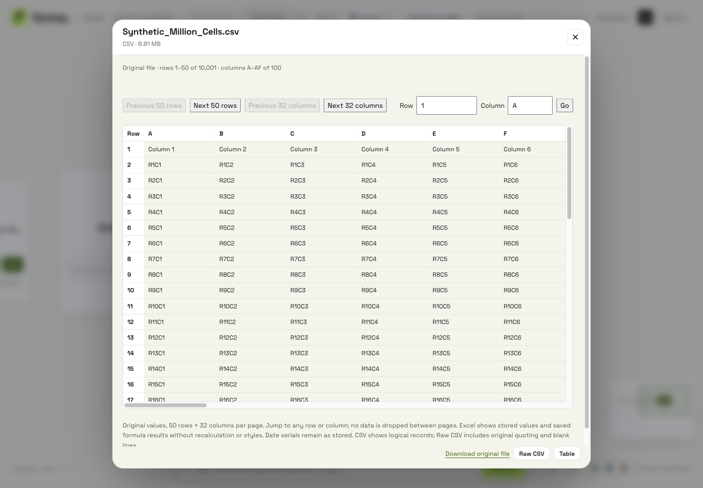
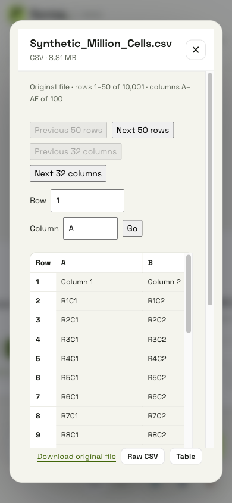

# Large spreadsheet viewing — local qualification

2026-11-02, `pivot/local-ui-iteration`, application checkout `forma-pitch-mvp`. Requested by Victor during the local UI loop. No push, PR, deployment or hosted sign-in qualification occurred. [Decision and limits](../../../docs/architecture/SPREADSHEET-VIEWING.md).

## Changed behavior

The immutable original is viewed through a dedicated read-only `view` parser profile. Output is bounded to 50 rows × 32 columns; the viewer exposes global dimensions, row/column paging and direct jumps. CSV quoting and blank lines remain available through paginated raw text and exact-byte download. XLSX saved formula results are marked; absent saved results are explicitly labeled. Formulas never execute. Original-value viewing does not promise Excel styling, merged-cell layout or recalculation.

The sealed parser retains whole-input validation, bounded resources and malicious archive refusals. The server binds pages to the requested file digest, sheet and window, checks authorization before and after parsing, and admits at most two concurrent original reads. Ask and Make an app retain the existing strict typed import path (including 32 fields and formula-free data); refusal messages explain that distinction rather than silently selecting or dropping columns.

## Actual browser results on port 4001

Private file contents were neither committed nor sent to a model. Checks used existing local stored originals; only filenames, dimensions and outcome metadata are recorded here.

| File | Diagnosis | Verified result |
| --- | --- | --- |
| `wappalyzer_getforma-dev.csv` | 153 columns exceeded the old viewer's strict import limit | Both records visible; jump to the final DY–EW window returned all 25 remaining columns |
| `Formative Export - CSS Certification Test Practice - 2_12_2025, 2_32_06 AM.csv` | 147 columns, including ragged records | 82 logical records retained; final rows 51–82 and columns DY–EQ visible, with original positions intact |
| `Gradebook_Midwood.xlsx` | Ordinary ZIP data descriptors were refused; formulas also exceeded strict import support | 35 × 10 original grid; all 62 saved formula results marked, including six valid saved empty strings; no missing formula cache |
| Synthetic million-cell CSV | 8,810,392 bytes, 10,001 records × 100 columns | First page: 1,600 rendered cells in about 2.24 s; direct final jump: four cells in about 1.35 s, ending at `R10000C100` |

The synthetic CSV's raw-text view showed 135 bounded text pages, with 65,536 characters on the first page and working Next navigation. At 390 × 844, the modal remained within the viewport (about 359 px wide); the table scrolled within its own container. At 1440 × 1000, paging, direct jumps and the original download remained accessible. The synthetic file remains in the local `Local viewer checks` folder for manual reuse.





## Checks completed

- `npm --prefix app/admin run typecheck`: passed.
- `npm --prefix app/admin test`: 195 passed, including page geometry, Unicode boundaries, formula metadata, request binding and column labels through XFD.
- `cargo fmt --check`: passed.
- `cargo test --locked -p forma-app-platform --lib boxes::`: 39 passed, one intentional ignored live-model test.
- `cargo test --locked -p forma-app-platform --lib imports::sandbox::`: nine passed, one intentional ignored external-runtime test.
- `cargo test --locked -p forma-app-platform --lib --features dev-stand dev::listener_tests`: one passed; listener count changes without changing the seeded persona world.
- Parser host suite against the rebuilt WASM guest: one host unit, nine job protocol and 23 qualification tests passed. Coverage includes strict legacy behavior, first/final wide pages, ragged records, cached/missing formula results, malformed descriptors, CRC mismatches, macros/external links, DTDs, Unicode limits and 256 deterministic malformed-input trials. Isolated build commands are recorded below.
- `just parser`: rebuilt the live checkout's parser successfully before the server restart.
- `just campaign box`: passed, including original-page authorization/revocation, 153-column paging, provenance and existing folder/app behavior. An initial run caught a stale assertion for the revised Ask refusal message; the assertion was updated and the campaign passed on rerun.
- `just check clippy http-smoke`: both passed, including the native no-store/CSP and uniform-denial checks.
- `bash -n scripts/dev/env.sh scripts/dev/server.sh`: passed; six isolated dev configuration cases also passed (defaults, opt-in, reset and file precedence/validation).
- Independent parser/security review found and fixed silent cached-value loss for ambiguous XML ordering and CDATA; these inputs are refused and covered by regression tests.
- Final independent read-only review of frontend paging, response validation, backend authorization/concurrency and single-persona behavior found no further blockers.
- `python3 Tickets/_tools/board.py render`, `python3 Tickets/_tools/board.py check` and `git diff --check`: passed.

Parser commands, from the repository's `parser/` directory (the initial host-test compilation exhausted disk space; this completed after the authorized cleanup):

```sh
CARGO_TARGET_DIR="$PWD/../.cache/parser-view-guest" \
  cargo build --locked --release -p parser-guest --target wasm32-unknown-unknown

PARSER_GUEST_WASM="$PWD/../.cache/parser-view-guest/wasm32-unknown-unknown/release/parser_guest.wasm" \
CARGO_TARGET_DIR="$PWD/../.cache/parser-view-target" \
CARGO_BUILD_JOBS=1 \
  cargo test --locked --release -p parser-host -- --test-threads=1 --nocapture
```

No `PARSER_HOST_BIN` override was needed: job tests used Cargo's matching built binary. `cargo fmt --manifest-path parser/Cargo.toml --all --check` also passed from the repository root.

Synthetic parser measurements: 153,000-cell CSV in 22 ms with 6.2 MB guest memory; 153,000-cell XLSX in 382 ms with 18.9 MB guest memory. Each returned only its requested 1,250-cell final window. These local measurements are examples, not service guarantees. Parser fuel, memory, expansion and input limits remain enforced.

## Local environment and cleanup

Docker Desktop was restarted. Its preserved PostgreSQL volume had a zero-filled stale process lock after shutdown. The stopped volume was backed up locally before moving that invalid lock aside; a stopped container with a similarly invalid runtime socket lock was recreated against the same volume. No database reset or volume deletion occurred. Existing uploaded originals were then verified through the browser.

Only the 4001 Forma preview remains running. The 4002/4003 listeners are disabled through the new literal `GENUI_DEV_SINGLE_PERSONA=1` setting; accounts and data remain intact. The clean profile and other verified old preview supervisors were stopped. The required local database and supervisor remain running.

The existing workspace `clean-build-artifacts.sh` helper was run in dry-run and apply modes, excluding this entire checkout and the three other active checkouts. After verifying no active process used the candidates, it removed 38 unused build/dependency directories and increased measured free space by 52,701,790,208 bytes (52.7 GB). Source, saved data, notes and evidence were preserved. The broad cleanup wrapper and `just clean target/all` were not used because they include worktrees or current preview state.

After qualification, this iteration's three temporary duplicate parser build directories (`.cache/parser-view-target`, `.cache/parser-view-guest`, `.cache/parser-view-check`) were also removed after an open-file check, reclaiming about 1.09 GB of allocated space. The live `.cache/parser-target`, current `target`, admin assets and `.cache/dev` were retained.

Full local test/cleanup logs remain under `/tmp/forma-*.log`; private recovery backup and runtime state remain gitignored. Broader final-PR review and testing are deferred to Victor's explicit push instruction.
